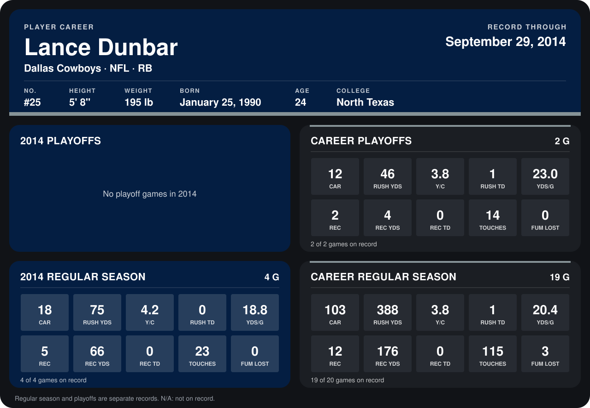

# Lance Dunbar

## Career stats

### Regular season

| Season | Team | Age | # | G | CAR | RUSH YDS | Y/C | RUSH TD | YDS/G | REC | REC YDS | REC TD | TOUCHES | FUM LOST |
|---|---|---:|---:|---:|---:|---:|---:|---:|---:|---:|---:|---:|---:|---:|
| 2013 | Dallas Cowboys | 23 | 25 | 15 | 85 | 313 | 3.7 | 1 | 20.9 | 7 | 110 | 0 | 92 | 3 |
| 2014 | Dallas Cowboys | 24 | 25 | 4 | 18 | 75 | 4.2 | 0 | 18.8 | 5 | 66 | 0 | 23 | 0 |
| **Career** |  |  |  | 19 | 103 | 388 | 3.8 | 1 | 20.4 | 12 | 176 | 0 | 115 | 3 |

### Playoffs

| Season | Team | Age | # | G | CAR | RUSH YDS | Y/C | RUSH TD | YDS/G | REC | REC YDS | REC TD | TOUCHES | FUM LOST |
|---|---|---:|---:|---:|---:|---:|---:|---:|---:|---:|---:|---:|---:|---:|
| 2013 | Dallas Cowboys | 23 | 25 | 2 | 12 | 46 | 3.8 | 1 | 23.0 | 2 | 4 | 0 | 14 | 0 |
| **Career** |  |  |  | 2 | 12 | 46 | 3.8 | 1 | 23.0 | 2 | 4 | 0 | 14 | 0 |

## Awards

None on record.

Age is his age on the league's opening game of each season; # is the number listed for him that season with that team (2014: the card's rule; 2013: the 2013 season roster), N/A where no listing applies.

Records through September 28, 2014. Identity: listed 2014 roster data, Weeks 1-4; number: 2014 Week 1 roster. [All Dallas Cowboys players](README.md).
