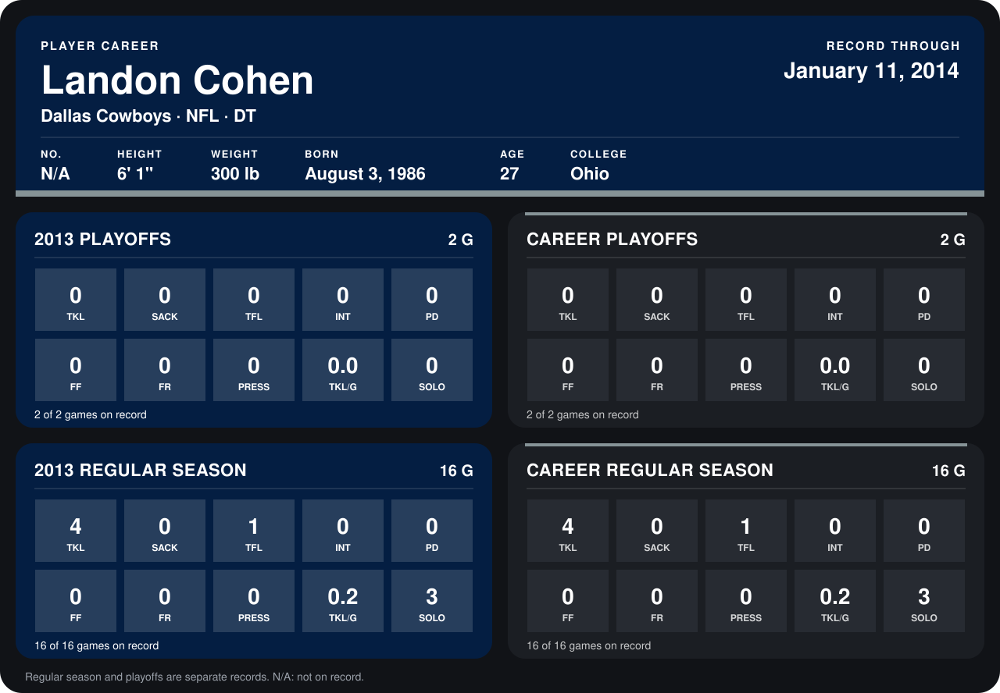

# Landon Cohen

## Career stats

### Regular season

| Season | Club | G | TKL | SACK | TFL | INT | PD | FF | FR | PRESS | TKL/G | SOLO |
|---|---|---:|---:|---:|---:|---:|---:|---:|---:|---:|---:|---:|
| 2013 | Dallas Cowboys | 16 | 4 | 0 | 1 | 0 | 0 | 0 | 0 | 0 | 0.2 | 3 |
| **Career** |  | 16 | 4 | 0 | 1 | 0 | 0 | 0 | 0 | 0 | 0.2 | 3 |

### Playoffs

| Season | Club | G | TKL | SACK | TFL | INT | PD | FF | FR | PRESS | TKL/G | SOLO |
|---|---|---:|---:|---:|---:|---:|---:|---:|---:|---:|---:|---:|
| 2013 | Dallas Cowboys | 2 | 0 | 0 | 0 | 0 | 0 | 0 | 0 | 0 | 0.0 | 0 |
| **Career** |  | 2 | 0 | 0 | 0 | 0 | 0 | 0 | 0 | 0 | 0.0 | 0 |

## Awards

None on record.

Records through January 11, 2014. Identity: his listed 2013 season roster data (no 2014 Weeks 1-4 roster row). [All Dallas Cowboys players](README.md).
