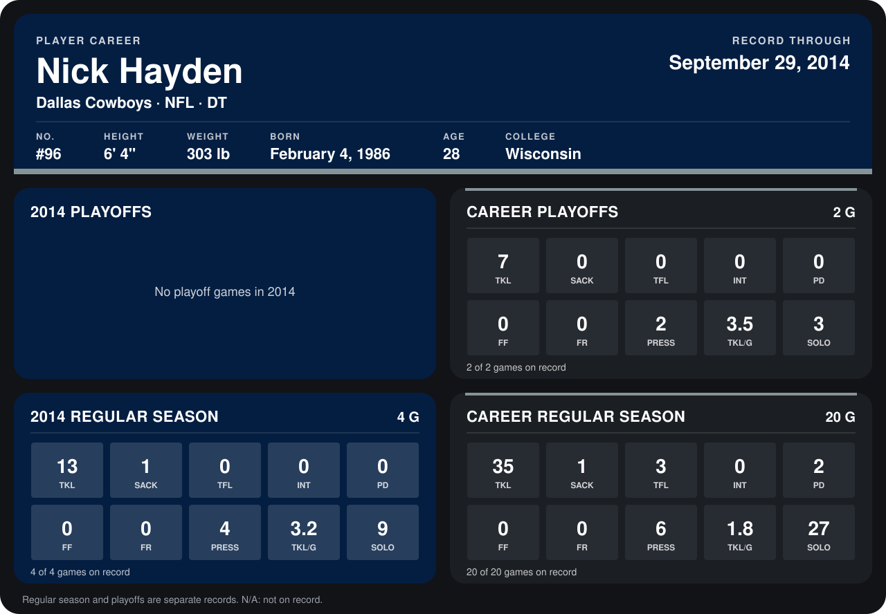

# Nick Hayden

## Career stats

### Regular season

| Season | Club | G | TKL | SACK | TFL | INT | PD | FF | FR | PRESS | TKL/G | SOLO |
|---|---|---:|---:|---:|---:|---:|---:|---:|---:|---:|---:|---:|
| 2013 | Dallas Cowboys | 16 | 22 | 0 | 3 | 0 | 2 | 0 | 0 | 2 | 1.4 | 18 |
| 2014 | Dallas Cowboys | 4 | 13 | 1 | 0 | 0 | 0 | 0 | 0 | 4 | 3.2 | 9 |
| **Career** |  | 20 | 35 | 1 | 3 | 0 | 2 | 0 | 0 | 6 | 1.8 | 27 |

### Playoffs

| Season | Club | G | TKL | SACK | TFL | INT | PD | FF | FR | PRESS | TKL/G | SOLO |
|---|---|---:|---:|---:|---:|---:|---:|---:|---:|---:|---:|---:|
| 2013 | Dallas Cowboys | 2 | 7 | 0 | 0 | 0 | 0 | 0 | 0 | 2 | 3.5 | 3 |
| **Career** |  | 2 | 7 | 0 | 0 | 0 | 0 | 0 | 0 | 2 | 3.5 | 3 |

## Awards

None on record.

Records through September 28, 2014. Identity: listed 2014 roster data, Weeks 1-4; number: 2014 Week 1 roster. [All Dallas Cowboys players](README.md).
