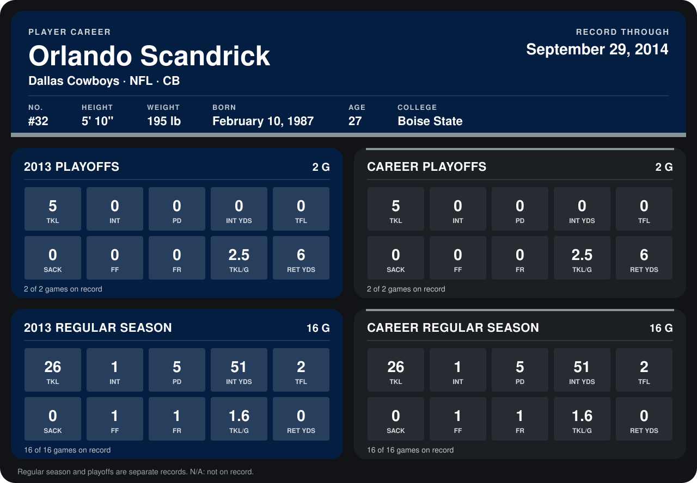

# Orlando Scandrick

## Career stats

### Regular season

| Season | Club | G | TKL | INT | PD | INT YDS | TFL | SACK | FF | FR | TKL/G | RET YDS |
|---|---|---:|---:|---:|---:|---:|---:|---:|---:|---:|---:|---:|
| 2013 | Dallas Cowboys | 16 | 26 | 1 | 5 | 51 | 2 | 0 | 1 | 1 | 1.6 | 0 |
| **Career** |  | 16 | 26 | 1 | 5 | 51 | 2 | 0 | 1 | 1 | 1.6 | 0 |

### Playoffs

| Season | Club | G | TKL | INT | PD | INT YDS | TFL | SACK | FF | FR | TKL/G | RET YDS |
|---|---|---:|---:|---:|---:|---:|---:|---:|---:|---:|---:|---:|
| 2013 | Dallas Cowboys | 2 | 5 | 0 | 0 | 0 | 0 | 0 | 0 | 0 | 2.5 | 6 |
| **Career** |  | 2 | 5 | 0 | 0 | 0 | 0 | 0 | 0 | 0 | 2.5 | 6 |

## Awards

None on record.

Records through September 29, 2014. Identity: listed 2014 roster data, Weeks 1-4; number: 2014 Week 4 roster listing. [All Dallas Cowboys players](README.md).
