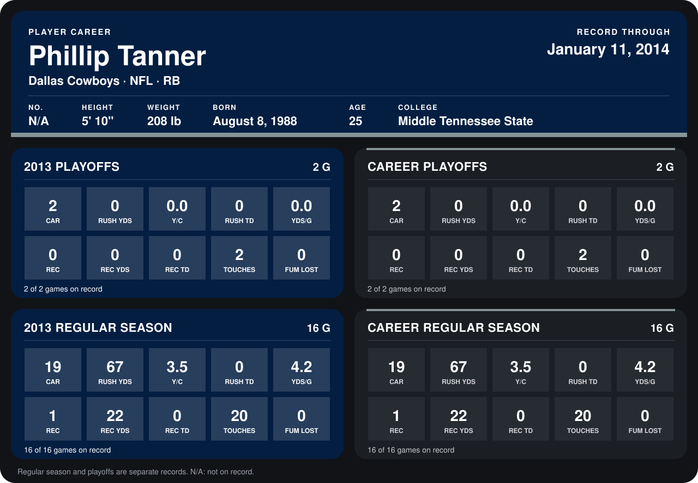

# Phillip Tanner

## Career stats

### Regular season

| Season | Club | G | CAR | RUSH YDS | Y/C | RUSH TD | YDS/G | REC | REC YDS | REC TD | TOUCHES | FUM LOST |
|---|---|---:|---:|---:|---:|---:|---:|---:|---:|---:|---:|---:|
| 2013 | Dallas Cowboys | 16 | 19 | 67 | 3.5 | 0 | 4.2 | 1 | 22 | 0 | 20 | 0 |
| **Career** |  | 16 | 19 | 67 | 3.5 | 0 | 4.2 | 1 | 22 | 0 | 20 | 0 |

### Playoffs

| Season | Club | G | CAR | RUSH YDS | Y/C | RUSH TD | YDS/G | REC | REC YDS | REC TD | TOUCHES | FUM LOST |
|---|---|---:|---:|---:|---:|---:|---:|---:|---:|---:|---:|---:|
| 2013 | Dallas Cowboys | 2 | 2 | 0 | 0.0 | 0 | 0.0 | 0 | 0 | 0 | 2 | 0 |
| **Career** |  | 2 | 2 | 0 | 0.0 | 0 | 0.0 | 0 | 0 | 0 | 2 | 0 |

## Awards

None on record.

Records through January 11, 2014. Identity: his listed 2013 season roster data (no 2014 Weeks 1-4 roster row). [All Dallas Cowboys players](README.md).
