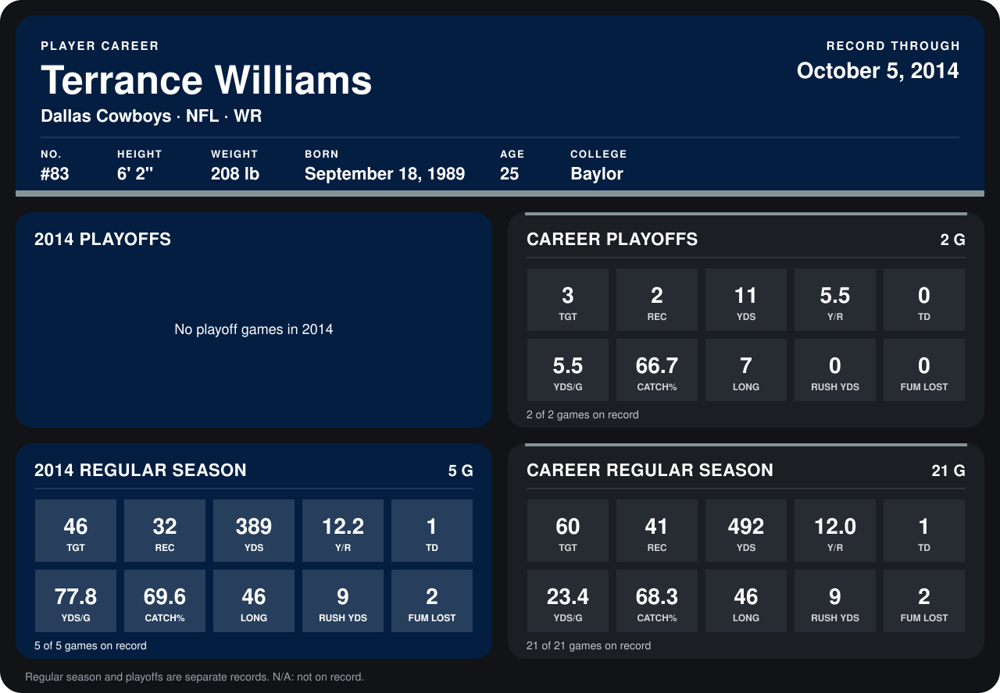

# Terrance Williams

## Career stats

### Regular season

| Season | Team | Age | # | G | TGT | REC | YDS | Y/R | TD | YDS/G | CATCH% | LONG | RUSH YDS | FUM LOST |
|---|---|---:|---:|---:|---:|---:|---:|---:|---:|---:|---:|---:|---:|---:|
| 2013 | Dallas Cowboys | 23 | 83 | 16 | 14 | 9 | 103 | 11.4 | 0 | 6.4 | 64.3 | 26 | 0 | 0 |
| 2014 | Dallas Cowboys | 24 | 83 | 5 | 46 | 32 | 389 | 12.2 | 1 | 77.8 | 69.6 | 46 | 9 | 2 |
| **Career** |  |  |  | 21 | 60 | 41 | 492 | 12.0 | 1 | 23.4 | 68.3 | 46 | 9 | 2 |

### Playoffs

| Season | Team | Age | # | G | TGT | REC | YDS | Y/R | TD | YDS/G | CATCH% | LONG | RUSH YDS | FUM LOST |
|---|---|---:|---:|---:|---:|---:|---:|---:|---:|---:|---:|---:|---:|---:|
| 2013 | Dallas Cowboys | 23 | 83 | 2 | 3 | 2 | 11 | 5.5 | 0 | 5.5 | 66.7 | 7 | 0 | 0 |
| **Career** |  |  |  | 2 | 3 | 2 | 11 | 5.5 | 0 | 5.5 | 66.7 | 7 | 0 | 0 |

## Awards

None on record.

Age is his age on the league's opening game of each season; # is the number listed for him that season with that team (2014: the card's rule; 2013: the 2013 season roster), N/A where no listing applies.

Records through October 5, 2014. Identity: listed 2014 roster data, Weeks 1-4; number: 2014 Week 1 roster. [All Dallas Cowboys players](README.md).
