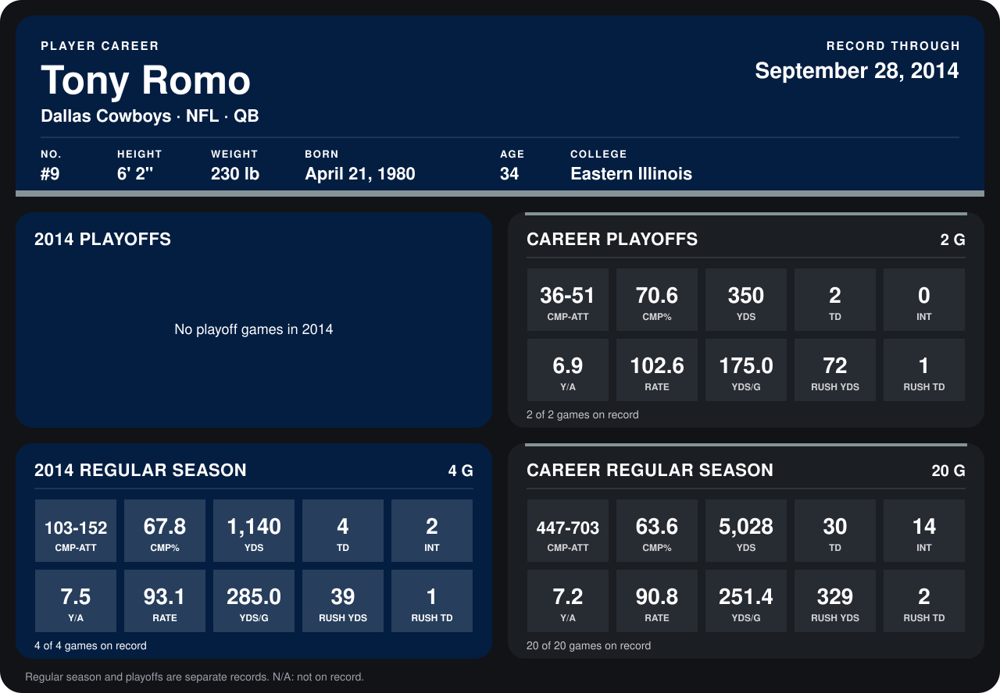

# Tony Romo

## Career stats

### Regular season

| Season | Club | G | CMP-ATT | CMP% | YDS | TD | INT | Y/A | RATE | YDS/G | RUSH YDS | RUSH TD |
|---|---|---:|---:|---:|---:|---:|---:|---:|---:|---:|---:|---:|
| 2013 | Dallas Cowboys | 16 | 344-551 | 62.4 | 3,888 | 26 | 12 | 7.1 | 90.2 | 243.0 | 290 | 1 |
| 2014 | Dallas Cowboys | 5 | 126-188 | 67.0 | 1,391 | 4 | 3 | 7.4 | 89.2 | 278.2 | 42 | 1 |
| **Career** |  | 21 | 470-739 | 63.6 | 5,279 | 30 | 15 | 7.1 | 89.9 | 251.4 | 332 | 2 |

### Playoffs

| Season | Club | G | CMP-ATT | CMP% | YDS | TD | INT | Y/A | RATE | YDS/G | RUSH YDS | RUSH TD |
|---|---|---:|---:|---:|---:|---:|---:|---:|---:|---:|---:|---:|
| 2013 | Dallas Cowboys | 2 | 36-51 | 70.6 | 350 | 2 | 0 | 6.9 | 102.6 | 175.0 | 72 | 1 |
| **Career** |  | 2 | 36-51 | 70.6 | 350 | 2 | 0 | 6.9 | 102.6 | 175.0 | 72 | 1 |

## Awards

- NFC Offensive Player of the Week (2013, Week 4)

Records through October 5, 2014. Identity: listed 2014 roster data, Weeks 1-4; number: 2014 Week 1 roster. [All Dallas Cowboys players](README.md).
