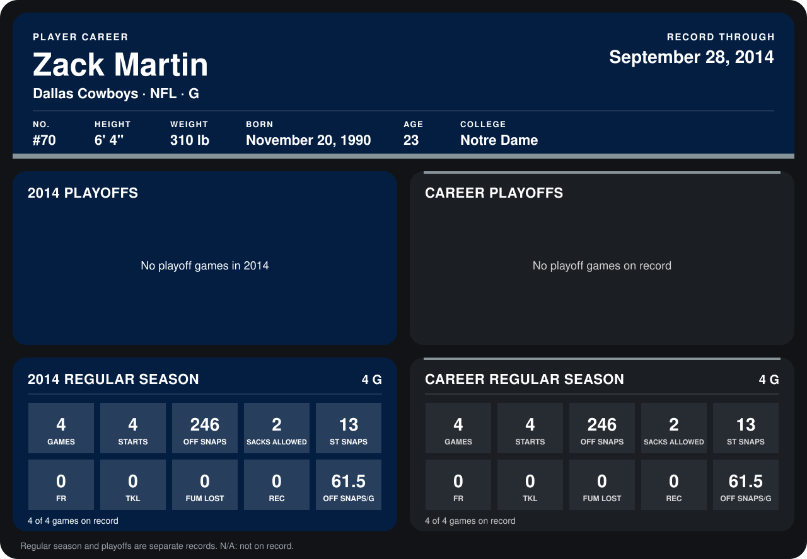

# Zack Martin

## Career stats

### Regular season

| Season | Club | G | STARTS | OFF SNAPS | SACKS ALLOWED | ST SNAPS | FR | TKL | FUM LOST | REC | OFF SNAPS/G |
|---|---|---:|---:|---:|---:|---:|---:|---:|---:|---:|---:|
| 2014 | Dallas Cowboys | 4 | 4 | 246 | 2 | 13 | 0 | 0 | 0 | 0 | 61.5 |
| **Career** |  | 4 | 4 | 246 | 2 | 13 | 0 | 0 | 0 | 0 | 61.5 |

### Playoffs

No playoff games on record.

## Awards

None on record.

Records through September 29, 2014. Identity: listed 2014 roster data, Weeks 1-4; number: 2014 Week 1 roster. [All Dallas Cowboys players](README.md).
