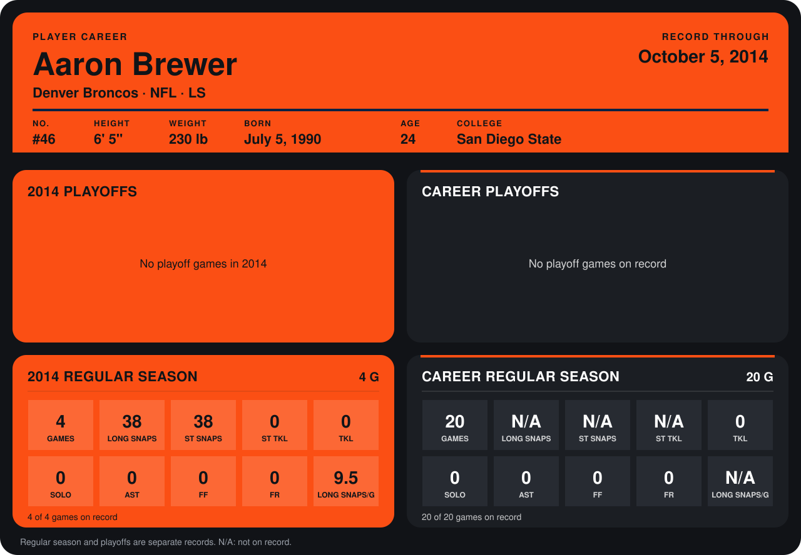

# Aaron Brewer

## Career stats

### Regular season

| Season | Club | G | LONG SNAPS | ST SNAPS | ST TKL | TKL | SOLO | AST | FF | FR | LONG SNAPS/G |
|---|---|---:|---:|---:|---:|---:|---:|---:|---:|---:|---:|
| 2013 | Denver Broncos | 16 | N/A | N/A | N/A | 0 | 0 | 0 | 0 | 0 | N/A |
| 2014 | Denver Broncos | 4 | 38 | 38 | 0 | 0 | 0 | 0 | 0 | 0 | 9.5 |
| **Career** |  | 20 | N/A | N/A | N/A | 0 | 0 | 0 | 0 | 0 | N/A |

### Playoffs

No playoff games on record.

## Awards

None on record.

Records through October 5, 2014. Identity: listed 2014 roster data, Weeks 1-4; number: 2014 Week 1 roster. [All Denver Broncos players](README.md).
