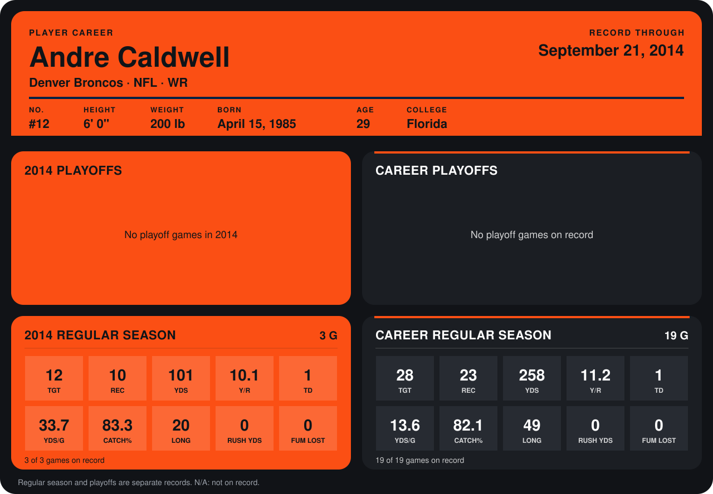

# Andre Caldwell

## Career stats

### Regular season

| Season | Club | G | TGT | REC | YDS | Y/R | TD | YDS/G | CATCH% | LONG | RUSH YDS | FUM LOST |
|---|---|---:|---:|---:|---:|---:|---:|---:|---:|---:|---:|---:|
| 2013 | Denver Broncos | 16 | 16 | 13 | 157 | 12.1 | 0 | 9.8 | 81.2 | 49 | 0 | 0 |
| 2014 | Denver Broncos | 4 | 14 | 11 | 107 | 9.7 | 1 | 26.8 | 78.6 | 20 | 0 | 0 |
| **Career** |  | 20 | 30 | 24 | 264 | 11.0 | 1 | 13.2 | 80.0 | 49 | 0 | 0 |

### Playoffs

No playoff games on record.

## Awards

None on record.

Records through October 5, 2014. Identity: listed 2014 roster data, Weeks 1-4; number: 2014 Week 1 roster. [All Denver Broncos players](README.md).
