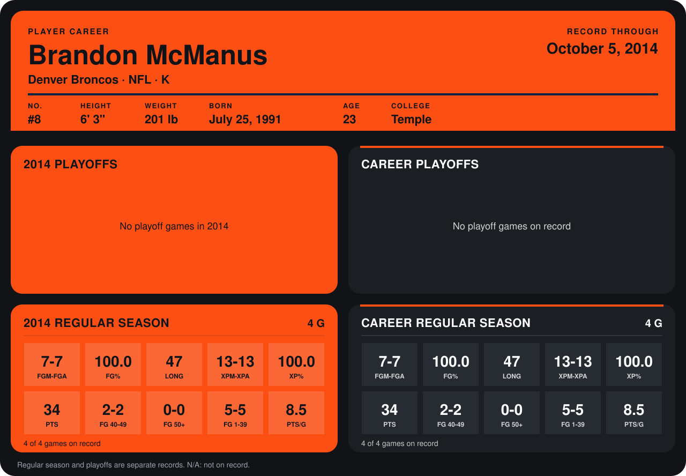

# Brandon McManus

## Career stats

### Regular season

| Season | Team | Age | # | G | FGM-FGA | FG% | LONG | XPM-XPA | XP% | PTS | FG 40-49 | FG 50+ | FG 1-39 | PTS/G |
|---|---|---:|---:|---:|---:|---:|---:|---:|---:|---:|---:|---:|---:|---:|
| 2014 | Denver Broncos | 23 | 8 | 3 | 6-6 | 100.0 | 47 | 11-11 | 100.0 | 29 | 2-2 | 0-0 | 4-4 | 9.7 |
| **Career** |  |  |  | 3 | 6-6 | 100.0 | 47 | 11-11 | 100.0 | 29 | 2-2 | 0-0 | 4-4 | 9.7 |

### Playoffs

No playoff games on record.

## Awards

None on record.

Age is his age on the league's opening game of each season; # is the number listed for him that season with that team (2014: the card's rule; 2013: the 2013 season roster), N/A where no listing applies.

Records through September 21, 2014. Identity: listed 2014 roster data, Weeks 1-4; number: 2014 Week 1 roster. [All Denver Broncos players](README.md).
