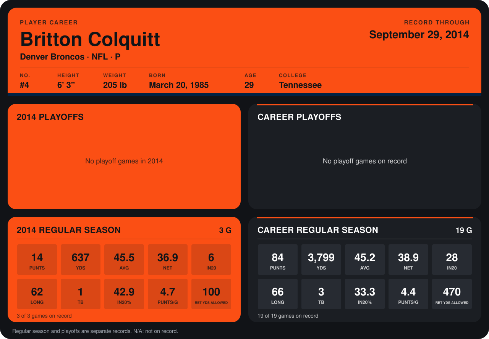

# Britton Colquitt

## Career stats

### Regular season

| Season | Club | G | PUNTS | YDS | AVG | NET | IN20 | LONG | TB | IN20% | PUNTS/G | RET YDS ALLOWED |
|---|---|---:|---:|---:|---:|---:|---:|---:|---:|---:|---:|---:|
| 2013 | Denver Broncos | 16 | 70 | 3,162 | 45.2 | 39.3 | 22 | 66 | 2 | 31.4 | 4.4 | 370 |
| 2014 | Denver Broncos | 3 | 14 | 637 | 45.5 | 36.9 | 6 | 62 | 1 | 42.9 | 4.7 | 100 |
| **Career** |  | 19 | 84 | 3,799 | 45.2 | 38.9 | 28 | 66 | 3 | 33.3 | 4.4 | 470 |

### Playoffs

No playoff games on record.

## Awards

None on record.

Records through September 29, 2014. Identity: listed 2014 roster data, Weeks 1-4; number: 2014 Week 1 roster. [All Denver Broncos players](README.md).
