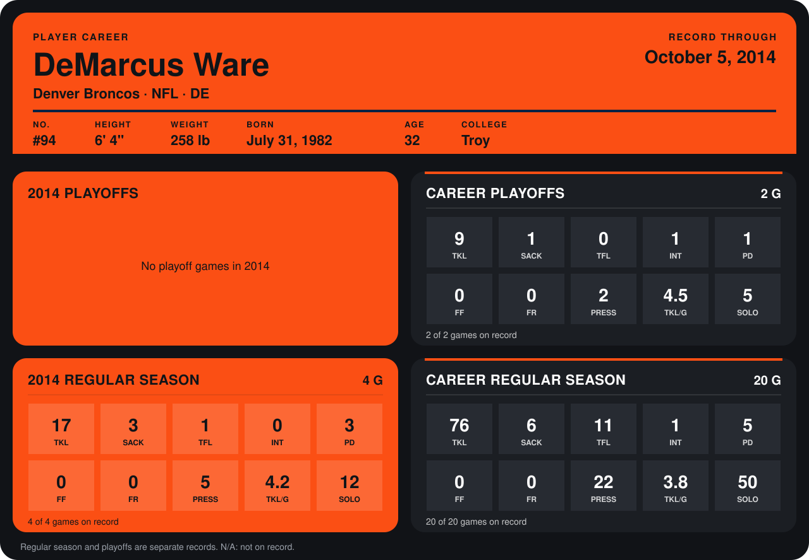

# DeMarcus Ware

## Career stats

### Regular season

| Season | Team | Age | # | G | TKL | SACK | TFL | INT | PD | FF | FR | PRESS | TKL/G | SOLO |
|---|---|---:|---:|---:|---:|---:|---:|---:|---:|---:|---:|---:|---:|---:|
| 2013 | Dallas Cowboys | 31 | 94 | 16 | 59 | 3 | 10 | 1 | 2 | 0 | 0 | 17 | 3.7 | 38 |
| 2014 | Denver Broncos | 32 | 94 | 3 | 10 | 2 | 1 | 0 | 2 | 0 | 0 | 4 | 3.3 | 7 |
| **Career** |  |  |  | 19 | 69 | 5 | 11 | 1 | 4 | 0 | 0 | 21 | 3.6 | 45 |

### Playoffs

| Season | Team | Age | # | G | TKL | SACK | TFL | INT | PD | FF | FR | PRESS | TKL/G | SOLO |
|---|---|---:|---:|---:|---:|---:|---:|---:|---:|---:|---:|---:|---:|---:|
| 2013 | Dallas Cowboys | 31 | 94 | 2 | 9 | 1 | 0 | 1 | 1 | 0 | 0 | 2 | 4.5 | 5 |
| **Career** |  |  |  | 2 | 9 | 1 | 0 | 1 | 1 | 0 | 0 | 2 | 4.5 | 5 |

## Awards

None on record.

Age is his age on the league's opening game of each season; # is the number listed for him that season with that team (2014: the card's rule; 2013: the 2013 season roster), N/A where no listing applies.

Records through September 21, 2014. Identity: listed 2014 roster data, Weeks 1-4; number: 2014 Week 1 roster. [All Denver Broncos players](README.md).
