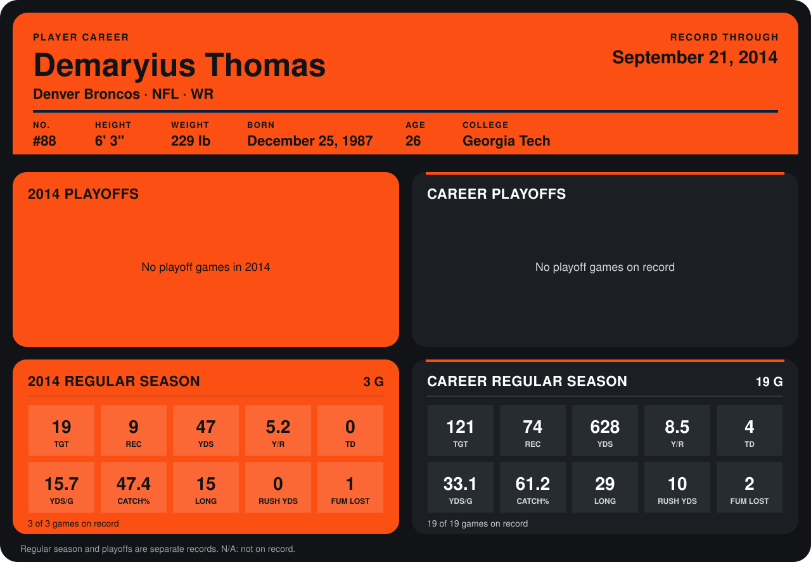

# Demaryius Thomas

## Career stats

### Regular season

| Season | Team | Age | # | G | TGT | REC | YDS | Y/R | TD | YDS/G | CATCH% | LONG | RUSH YDS | FUM LOST |
|---|---|---:|---:|---:|---:|---:|---:|---:|---:|---:|---:|---:|---:|---:|
| 2013 | Denver Broncos | 25 | 88 | 16 | 102 | 65 | 581 | 8.9 | 4 | 36.3 | 63.7 | 29 | 10 | 1 |
| 2014 | Denver Broncos | 26 | 88 | 3 | 19 | 9 | 47 | 5.2 | 0 | 15.7 | 47.4 | 15 | 0 | 1 |
| **Career** |  |  |  | 19 | 121 | 74 | 628 | 8.5 | 4 | 33.1 | 61.2 | 29 | 10 | 2 |

### Playoffs

No playoff games on record.

## Awards

None on record.

Age is his age on the league's opening game of each season; # is the number listed for him that season with that team (2014: the card's rule; 2013: the 2013 season roster), N/A where no listing applies.

Records through September 21, 2014. Identity: listed 2014 roster data, Weeks 1-4; number: 2014 Week 1 roster. [All Denver Broncos players](README.md).
