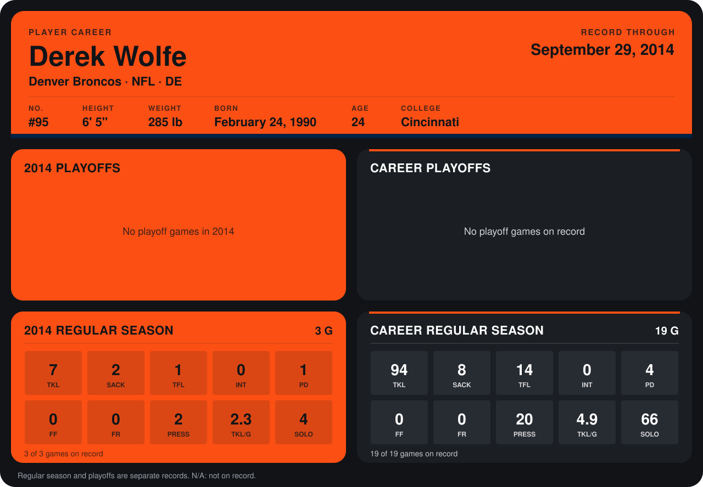

# Derek Wolfe

## Career stats

### Regular season

| Season | Club | G | TKL | SACK | TFL | INT | PD | FF | FR | PRESS | TKL/G | SOLO |
|---|---|---:|---:|---:|---:|---:|---:|---:|---:|---:|---:|---:|
| 2013 | Denver Broncos | 16 | 87 | 6 | 13 | 0 | 3 | 0 | 0 | 18 | 5.4 | 62 |
| 2014 | Denver Broncos | 3 | 7 | 2 | 1 | 0 | 1 | 0 | 0 | 2 | 2.3 | 4 |
| **Career** |  | 19 | 94 | 8 | 14 | 0 | 4 | 0 | 0 | 20 | 4.9 | 66 |

### Playoffs

No playoff games on record.

## Awards

None on record.

Records through September 21, 2014. Identity: listed 2014 roster data, Weeks 1-4; number: 2014 Week 1 roster. [All Denver Broncos players](README.md).
