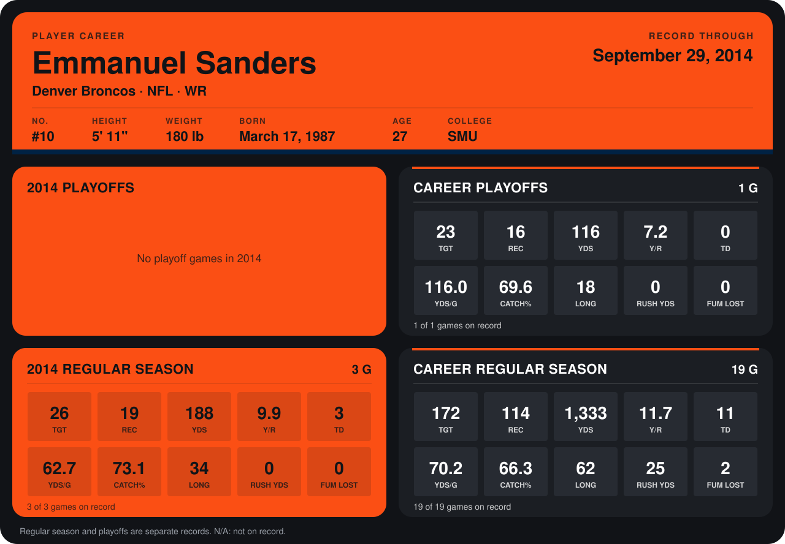

# Emmanuel Sanders

## Career stats

### Regular season

| Season | Team | Age | # | G | TGT | REC | YDS | Y/R | TD | YDS/G | CATCH% | LONG | RUSH YDS | FUM LOST |
|---|---|---:|---:|---:|---:|---:|---:|---:|---:|---:|---:|---:|---:|---:|
| 2013 | Pittsburgh Steelers | 26 | 88 | 16 | 146 | 95 | 1,145 | 12.1 | 8 | 71.6 | 65.1 | 62 | 25 | 2 |
| 2014 | Denver Broncos | 27 | 10 | 4 | 34 | 22 | 249 | 11.3 | 3 | 62.2 | 64.7 | 34 | -5 | 1 |
| **Career** |  |  |  | 20 | 180 | 117 | 1,394 | 11.9 | 11 | 69.7 | 65.0 | 62 | 20 | 3 |

### Playoffs

| Season | Team | Age | # | G | TGT | REC | YDS | Y/R | TD | YDS/G | CATCH% | LONG | RUSH YDS | FUM LOST |
|---|---|---:|---:|---:|---:|---:|---:|---:|---:|---:|---:|---:|---:|---:|
| 2013 | Pittsburgh Steelers | 26 | 88 | 1 | 23 | 16 | 116 | 7.2 | 0 | 116.0 | 69.6 | 18 | 0 | 0 |
| **Career** |  |  |  | 1 | 23 | 16 | 116 | 7.2 | 0 | 116.0 | 69.6 | 18 | 0 | 0 |

## Awards

None on record.

Age is his age on the league's opening game of each season; # is the number listed for him that season with that team (2014: the card's rule; 2013: the 2013 season roster), N/A where no listing applies.

Records through October 5, 2014. Identity: listed 2014 roster data, Weeks 1-4; number: 2014 Week 1 roster. [All Denver Broncos players](README.md).
