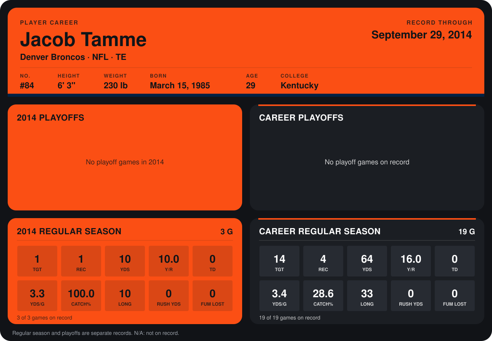

# Jacob Tamme

## Career stats

### Regular season

| Season | Team | Age | # | G | TGT | REC | YDS | Y/R | TD | YDS/G | CATCH% | LONG | RUSH YDS | FUM LOST |
|---|---|---:|---:|---:|---:|---:|---:|---:|---:|---:|---:|---:|---:|---:|
| 2013 | Denver Broncos | 28 | 84 | 16 | 13 | 3 | 54 | 18.0 | 0 | 3.4 | 23.1 | 33 | 0 | 0 |
| 2014 | Denver Broncos | 29 | 84 | 3 | 1 | 1 | 10 | 10.0 | 0 | 3.3 | 100.0 | 10 | 0 | 0 |
| **Career** |  |  |  | 19 | 14 | 4 | 64 | 16.0 | 0 | 3.4 | 28.6 | 33 | 0 | 0 |

### Playoffs

No playoff games on record.

## Awards

None on record.

Age is his age on the league's opening game of each season; # is the number listed for him that season with that team (2014: the card's rule; 2013: the 2013 season roster), N/A where no listing applies.

Records through September 21, 2014. Identity: listed 2014 roster data, Weeks 1-4; number: 2014 Week 1 roster. [All Denver Broncos players](README.md).
