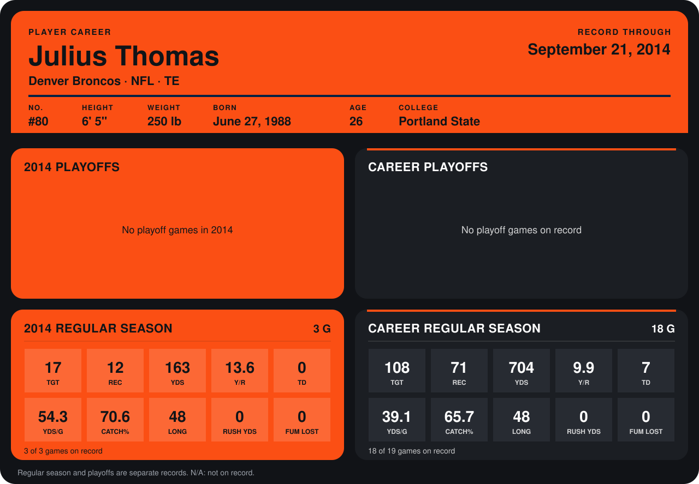

# Julius Thomas

## Career stats

### Regular season

| Season | Team | Age | # | G | TGT | REC | YDS | Y/R | TD | YDS/G | CATCH% | LONG | RUSH YDS | FUM LOST |
|---|---|---:|---:|---:|---:|---:|---:|---:|---:|---:|---:|---:|---:|---:|
| 2013 | Denver Broncos | 25 | 80 | 15 | 91 | 59 | 541 | 9.2 | 7 | 36.1 | 64.8 | 37 | 0 | 0 |
| 2014 | Denver Broncos | 26 | 80 | 4 | 25 | 18 | 199 | 11.1 | 0 | 49.8 | 72.0 | 48 | 0 | 0 |
| **Career** |  |  |  | 19 | 116 | 77 | 740 | 9.6 | 7 | 38.9 | 66.4 | 48 | 0 | 0 |

### Playoffs

No playoff games on record.

## Awards

None on record.

Age is his age on the league's opening game of each season; # is the number listed for him that season with that team (2014: the card's rule; 2013: the 2013 season roster), N/A where no listing applies.

Records through October 5, 2014. Identity: listed 2014 roster data, Weeks 1-4; number: 2014 Week 1 roster. [All Denver Broncos players](README.md).
