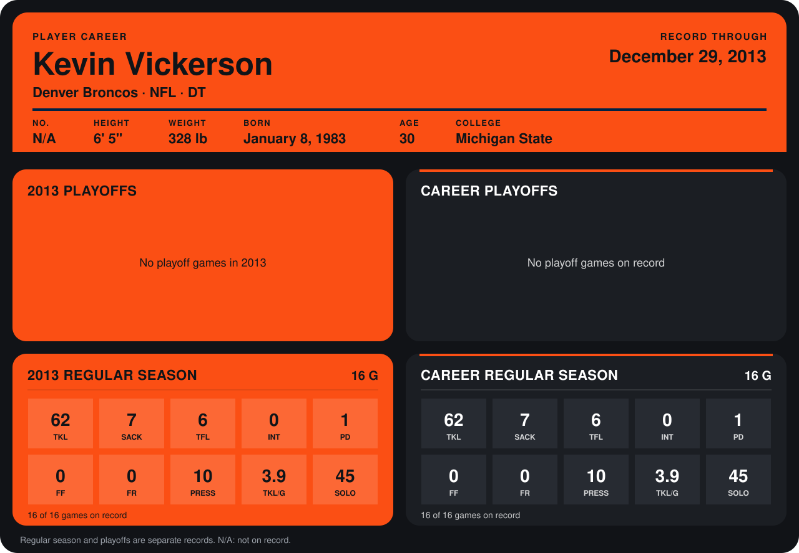

# Kevin Vickerson

## Career stats

### Regular season

| Season | Team | Age | # | G | TKL | SACK | TFL | INT | PD | FF | FR | PRESS | TKL/G | SOLO |
|---|---|---:|---:|---:|---:|---:|---:|---:|---:|---:|---:|---:|---:|---:|
| 2013 | Denver Broncos | 30 | 99 | 16 | 62 | 7 | 6 | 0 | 1 | 0 | 0 | 10 | 3.9 | 45 |
| **Career** |  |  |  | 16 | 62 | 7 | 6 | 0 | 1 | 0 | 0 | 10 | 3.9 | 45 |

### Playoffs

No playoff games on record.

## Awards

None on record.

Age is his age on the league's opening game of each season; # is the number listed for him that season with that team (2014: the card's rule; 2013: the 2013 season roster), N/A where no listing applies.

Records through December 29, 2013. Identity: listed 2014 roster data, Weeks 1-4. [All Denver Broncos players](README.md).
