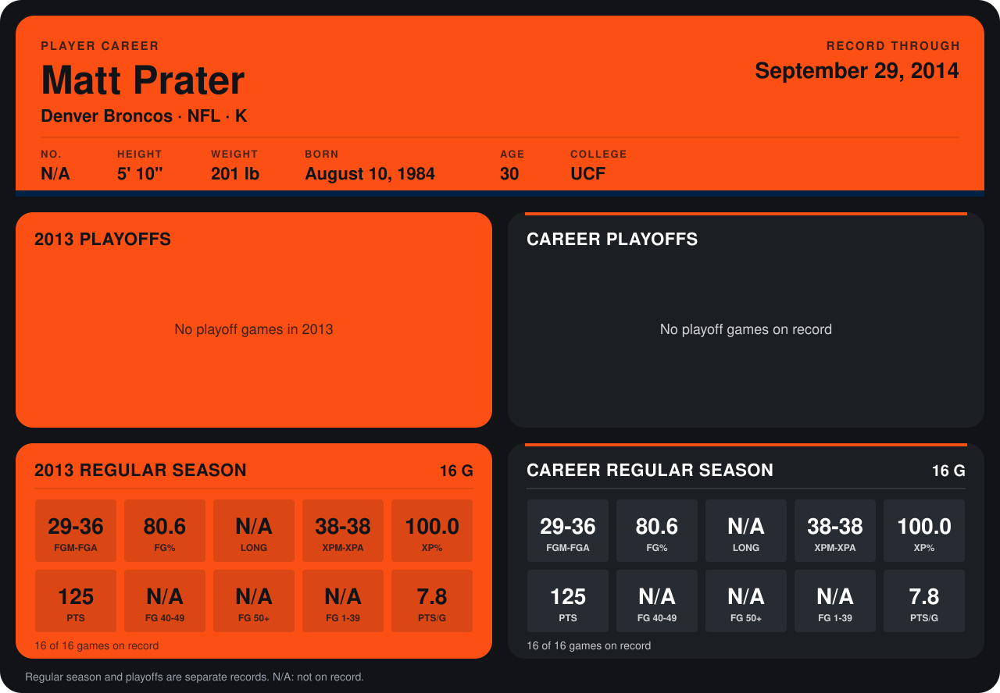

# Matt Prater

## Career stats

### Regular season

| Season | Team | Age | # | G | FGM-FGA | FG% | LONG | XPM-XPA | XP% | PTS | FG 40-49 | FG 50+ | FG 1-39 | PTS/G |
|---|---|---:|---:|---:|---:|---:|---:|---:|---:|---:|---:|---:|---:|---:|
| 2013 | Denver Broncos | 29 | 5 | 16 | 29-36 | 80.6 | N/A | 38-38 | 100.0 | 125 | N/A | N/A | N/A | 7.8 |
| **Career** |  |  |  | 16 | 29-36 | 80.6 | N/A | 38-38 | 100.0 | 125 | N/A | N/A | N/A | 7.8 |

### Playoffs

No playoff games on record.

## Awards

- AFC Special Teams Player of the Week (2013, Week 3)
- AFC Special Teams Player of the Week (2013, Week 8)
- AFC Special Teams Player of the Week (2013, Week 15)

Age is his age on the league's opening game of each season; # is the number listed for him that season with that team (2014: the card's rule; 2013: the 2013 season roster), N/A where no listing applies.

Records through December 29, 2013. Identity: his listed 2013 season roster data (no 2014 Weeks 1-4 roster row). [All Denver Broncos players](README.md).
