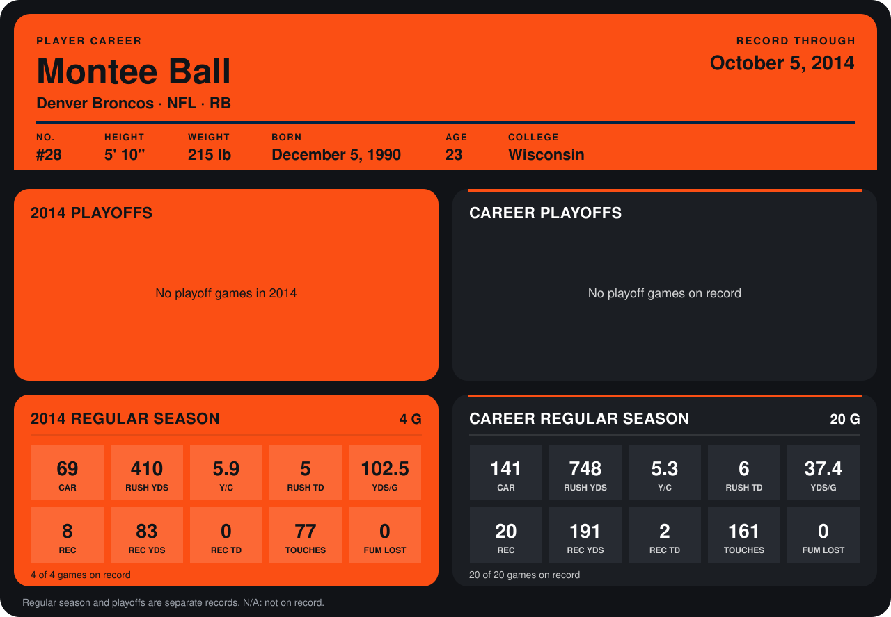

# Montee Ball

## Career stats

### Regular season

| Season | Club | G | CAR | RUSH YDS | Y/C | RUSH TD | YDS/G | REC | REC YDS | REC TD | TOUCHES | FUM LOST |
|---|---|---:|---:|---:|---:|---:|---:|---:|---:|---:|---:|---:|
| 2013 | Denver Broncos | 16 | 72 | 338 | 4.7 | 1 | 21.1 | 12 | 108 | 2 | 84 | 0 |
| 2014 | Denver Broncos | 3 | 58 | 372 | 6.4 | 5 | 124.0 | 5 | 46 | 0 | 63 | 0 |
| **Career** |  | 19 | 130 | 710 | 5.5 | 6 | 37.4 | 17 | 154 | 2 | 147 | 0 |

### Playoffs

No playoff games on record.

## Awards

None on record.

Records through September 29, 2014. Identity: listed 2014 roster data, Weeks 1-4; number: 2014 Week 1 roster. [All Denver Broncos players](README.md).
