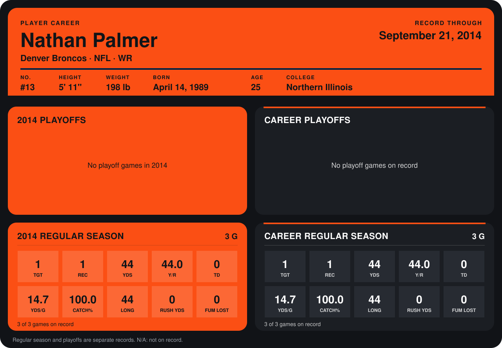

# Nathan Palmer

## Career stats

### Regular season

| Season | Club | G | TGT | REC | YDS | Y/R | TD | YDS/G | CATCH% | LONG | RUSH YDS | FUM LOST |
|---|---|---:|---:|---:|---:|---:|---:|---:|---:|---:|---:|---:|
| 2014 | Denver Broncos | 3 | 1 | 1 | 44 | 44.0 | 0 | 14.7 | 100.0 | 44 | 0 | 0 |
| **Career** |  | 3 | 1 | 1 | 44 | 44.0 | 0 | 14.7 | 100.0 | 44 | 0 | 0 |

### Playoffs

No playoff games on record.

## Awards

None on record.

Records through September 21, 2014. Identity: listed 2014 roster data, Weeks 1-4; number: 2014 Week 1 roster. [All Denver Broncos players](README.md).
