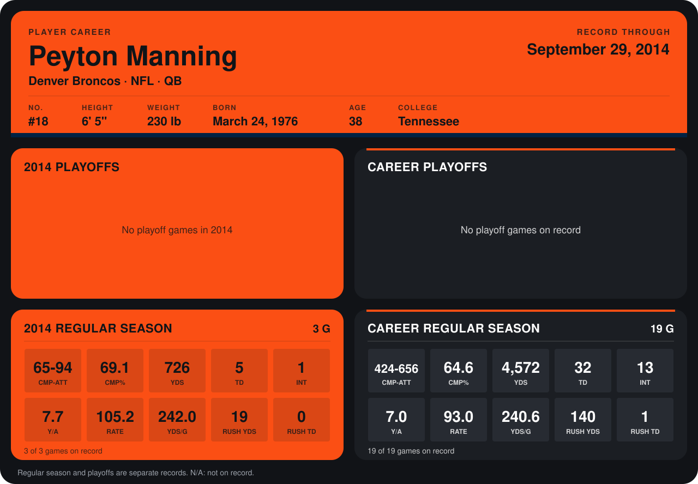

# Peyton Manning

## Career stats

### Regular season

| Season | Club | G | CMP-ATT | CMP% | YDS | TD | INT | Y/A | RATE | YDS/G | RUSH YDS | RUSH TD |
|---|---|---:|---:|---:|---:|---:|---:|---:|---:|---:|---:|---:|
| 2013 | Denver Broncos | 16 | 359-562 | 63.9 | 3,846 | 27 | 12 | 6.8 | 90.9 | 240.4 | 121 | 1 |
| 2014 | Denver Broncos | 4 | 86-127 | 67.7 | 943 | 6 | 1 | 7.4 | 101.9 | 235.8 | 25 | 0 |
| **Career** |  | 20 | 445-689 | 64.6 | 4,789 | 33 | 13 | 7.0 | 93.0 | 239.4 | 146 | 1 |

### Playoffs

No playoff games on record.

## Awards

- AFC Offensive Player of the Month (2013, December)

Records through October 5, 2014. Identity: listed 2014 roster data, Weeks 1-4; number: 2014 Week 1 roster. [All Denver Broncos players](README.md).
