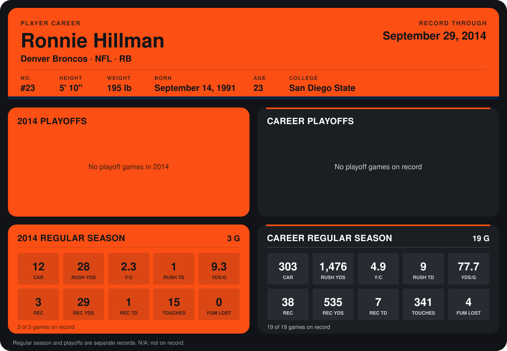

# Ronnie Hillman

## Career stats

### Regular season

| Season | Club | G | CAR | RUSH YDS | Y/C | RUSH TD | YDS/G | REC | REC YDS | REC TD | TOUCHES | FUM LOST |
|---|---|---:|---:|---:|---:|---:|---:|---:|---:|---:|---:|---:|
| 2013 | Denver Broncos | 16 | 291 | 1,448 | 5.0 | 8 | 90.5 | 35 | 506 | 6 | 326 | 4 |
| 2014 | Denver Broncos | 4 | 14 | 36 | 2.6 | 1 | 9.0 | 4 | 33 | 1 | 18 | 0 |
| **Career** |  | 20 | 305 | 1,484 | 4.9 | 9 | 74.2 | 39 | 539 | 7 | 344 | 4 |

### Playoffs

No playoff games on record.

## Awards

None on record.

Records through October 5, 2014. Identity: listed 2014 roster data, Weeks 1-4; number: 2014 Week 1 roster. [All Denver Broncos players](README.md).
