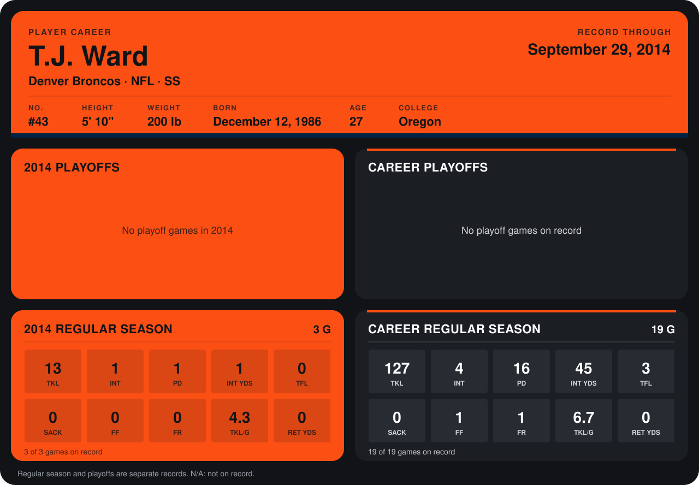

# T.J. Ward

## Career stats

### Regular season

| Season | Club | G | TKL | INT | PD | INT YDS | TFL | SACK | FF | FR | TKL/G | RET YDS |
|---|---|---:|---:|---:|---:|---:|---:|---:|---:|---:|---:|---:|
| 2013 | Cleveland Browns | 16 | 114 | 3 | 15 | 44 | 3 | 0 | 1 | 1 | 7.1 | 0 |
| 2014 | Denver Broncos | 4 | 17 | 1 | 1 | 1 | 0 | 0 | 0 | 0 | 4.2 | 0 |
| **Career** |  | 20 | 131 | 4 | 16 | 45 | 3 | 0 | 1 | 1 | 6.5 | 0 |

### Playoffs

No playoff games on record.

## Awards

- AFC Defensive Player of the Week (2013, Week 11)

Records through October 5, 2014. Identity: listed 2014 roster data, Weeks 1-4; number: 2014 Week 1 roster. [All Denver Broncos players](README.md).
