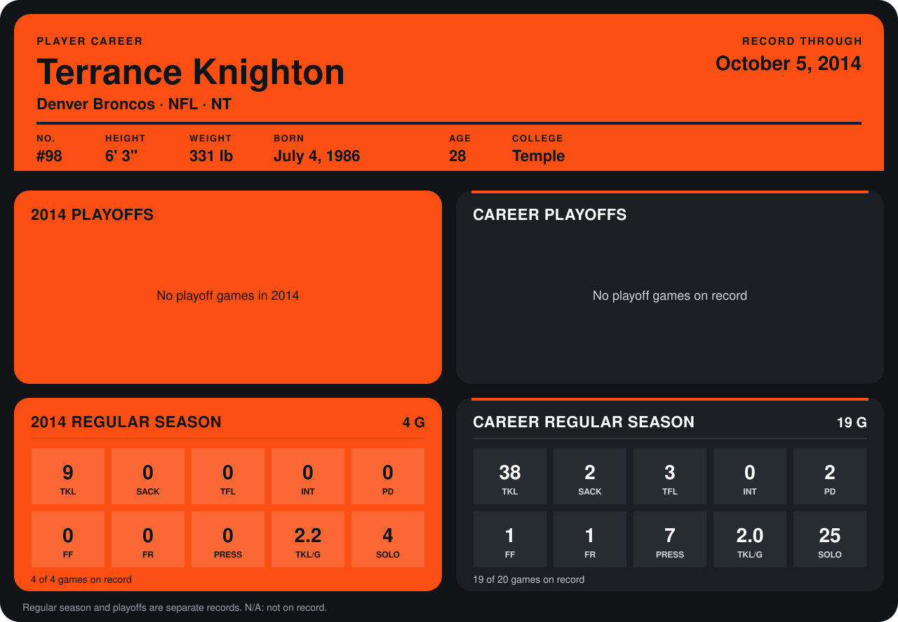

# Terrance Knighton

## Career stats

### Regular season

| Season | Club | G | TKL | SACK | TFL | INT | PD | FF | FR | PRESS | TKL/G | SOLO |
|---|---|---:|---:|---:|---:|---:|---:|---:|---:|---:|---:|---:|
| 2013 | Denver Broncos | 15 | 29 | 2 | 3 | 0 | 2 | 1 | 1 | 7 | 1.9 | 21 |
| 2014 | Denver Broncos | 4 | 9 | 0 | 0 | 0 | 0 | 0 | 0 | 0 | 2.2 | 4 |
| **Career** |  | 19 | 38 | 2 | 3 | 0 | 2 | 1 | 1 | 7 | 2.0 | 25 |

### Playoffs

No playoff games on record.

## Awards

None on record.

Records through October 5, 2014. Identity: listed 2014 roster data, Weeks 1-4; number: 2014 Week 1 roster. [All Denver Broncos players](README.md).
