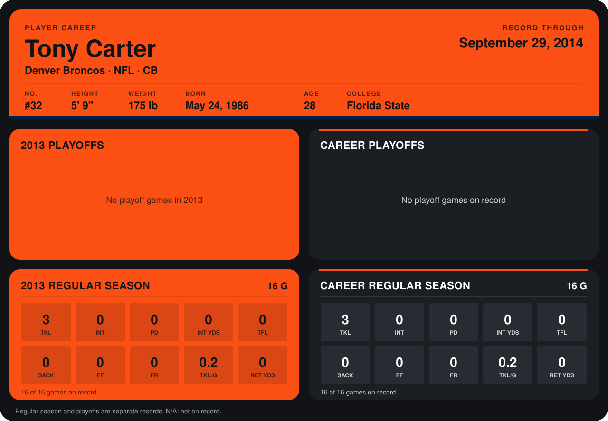

# Tony Carter

## Career stats

### Regular season

| Season | Club | G | TKL | INT | PD | INT YDS | TFL | SACK | FF | FR | TKL/G | RET YDS |
|---|---|---:|---:|---:|---:|---:|---:|---:|---:|---:|---:|---:|
| 2013 | Denver Broncos | 16 | 3 | 0 | 0 | 0 | 0 | 0 | 0 | 0 | 0.2 | 0 |
| **Career** |  | 16 | 3 | 0 | 0 | 0 | 0 | 0 | 0 | 0 | 0.2 | 0 |

### Playoffs

No playoff games on record.

## Awards

None on record.

Records through December 29, 2013. Identity: listed 2014 roster data, Weeks 1-4; number: 2014 Week 1 roster. [All Denver Broncos players](README.md).
