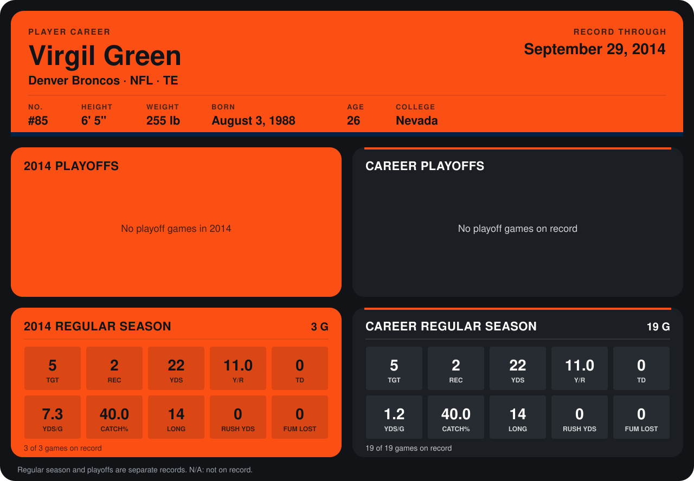

# Virgil Green

## Career stats

### Regular season

| Season | Club | G | TGT | REC | YDS | Y/R | TD | YDS/G | CATCH% | LONG | RUSH YDS | FUM LOST |
|---|---|---:|---:|---:|---:|---:|---:|---:|---:|---:|---:|---:|
| 2013 | Denver Broncos | 16 | 0 | 0 | 0 | N/A | 0 | 0.0 | N/A | N/A | 0 | 0 |
| 2014 | Denver Broncos | 3 | 5 | 2 | 22 | 11.0 | 0 | 7.3 | 40.0 | 14 | 0 | 0 |
| **Career** |  | 19 | 5 | 2 | 22 | 11.0 | 0 | 1.2 | 40.0 | 14 | 0 | 0 |

### Playoffs

No playoff games on record.

## Awards

None on record.

Records through September 29, 2014. Identity: listed 2014 roster data, Weeks 1-4; number: 2014 Week 1 roster. [All Denver Broncos players](README.md).
