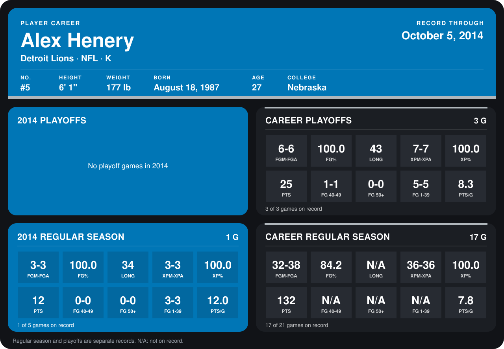

# Alex Henery

## Career stats

### Regular season

| Season | Club | G | FGM-FGA | FG% | LONG | XPM-XPA | XP% | PTS | FG 40-49 | FG 50+ | FG 1-39 | PTS/G |
|---|---|---:|---:|---:|---:|---:|---:|---:|---:|---:|---:|---:|
| 2013 | Philadelphia Eagles | 16 | 29-35 | 82.9 | N/A | 33-33 | 100.0 | 120 | N/A | N/A | N/A | 7.5 |
| 2014 | Detroit Lions | 1 | 3-3 | 100.0 | 34 | 3-3 | 100.0 | 12 | 0-0 | 0-0 | 3-3 | 12.0 |
| **Career** |  | 17 | 32-38 | 84.2 | N/A | 36-36 | 100.0 | 132 | N/A | N/A | N/A | 7.8 |

### Playoffs

| Season | Club | G | FGM-FGA | FG% | LONG | XPM-XPA | XP% | PTS | FG 40-49 | FG 50+ | FG 1-39 | PTS/G |
|---|---|---:|---:|---:|---:|---:|---:|---:|---:|---:|---:|---:|
| 2013 | Philadelphia Eagles | 3 | 6-6 | 100.0 | 43 | 7-7 | 100.0 | 25 | 1-1 | 0-0 | 5-5 | 8.3 |
| **Career** |  | 3 | 6-6 | 100.0 | 43 | 7-7 | 100.0 | 25 | 1-1 | 0-0 | 5-5 | 8.3 |

## Awards

None on record.

Records through October 5, 2014. Identity: listed 2014 roster data, Weeks 1-4; number: 2014 Week 4 roster listing. [All Detroit Lions players](README.md).
