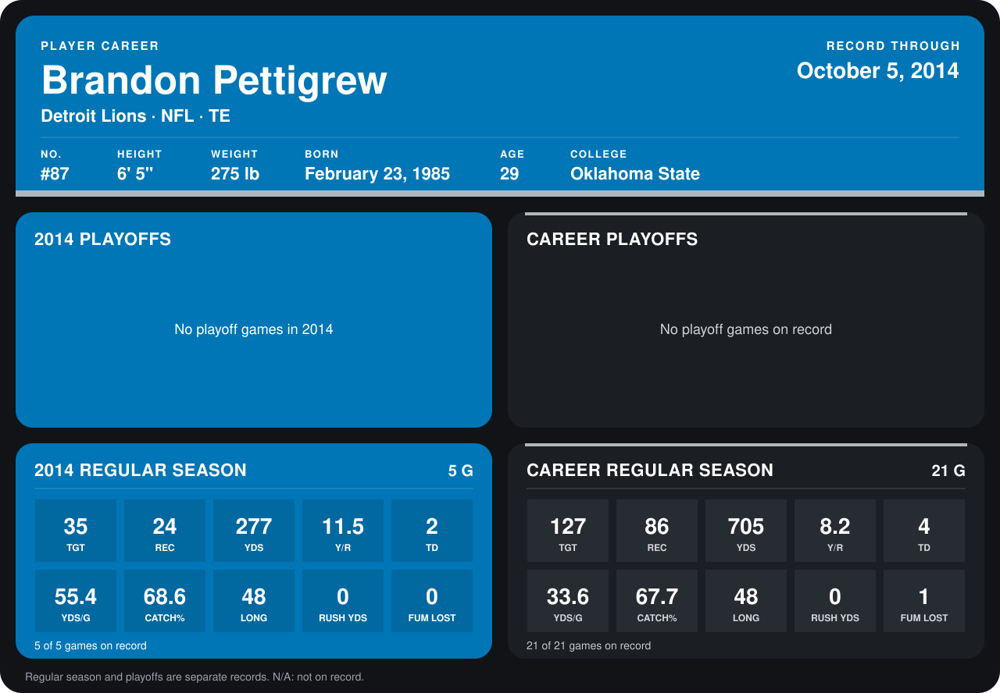

# Brandon Pettigrew

## Career stats

### Regular season

| Season | Club | G | TGT | REC | YDS | Y/R | TD | YDS/G | CATCH% | LONG | RUSH YDS | FUM LOST |
|---|---|---:|---:|---:|---:|---:|---:|---:|---:|---:|---:|---:|
| 2013 | Detroit Lions | 16 | 92 | 62 | 428 | 6.9 | 2 | 26.8 | 67.4 | 24 | 0 | 1 |
| 2014 | Detroit Lions | 4 | 26 | 16 | 182 | 11.4 | 2 | 45.5 | 61.5 | 48 | 0 | 0 |
| **Career** |  | 20 | 118 | 78 | 610 | 7.8 | 4 | 30.5 | 66.1 | 48 | 0 | 1 |

### Playoffs

No playoff games on record.

## Awards

None on record.

Records through September 29, 2014. Identity: listed 2014 roster data, Weeks 1-4; number: 2014 Week 1 roster. [All Detroit Lions players](README.md).
