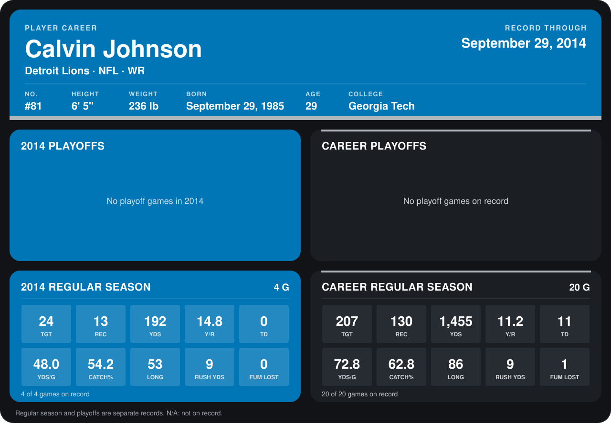

# Calvin Johnson

## Career stats

### Regular season

| Season | Team | Age | # | G | TGT | REC | YDS | Y/R | TD | YDS/G | CATCH% | LONG | RUSH YDS | FUM LOST |
|---|---|---:|---:|---:|---:|---:|---:|---:|---:|---:|---:|---:|---:|---:|
| 2013 | Detroit Lions | 27 | 81 | 16 | 183 | 117 | 1,263 | 10.8 | 11 | 78.9 | 63.9 | 86 | 0 | 1 |
| 2014 | Detroit Lions | 28 | 81 | 4 | 24 | 13 | 192 | 14.8 | 0 | 48.0 | 54.2 | 53 | 9 | 0 |
| **Career** |  |  |  | 20 | 207 | 130 | 1,455 | 11.2 | 11 | 72.8 | 62.8 | 86 | 9 | 1 |

### Playoffs

No playoff games on record.

## Awards

- AP First-Team All-Pro (2013, WR)
- Pro Bowl selection (2013, WR)

Age is his age on the league's opening game of each season; # is the number listed for him that season with that team (2014: the card's rule; 2013: the 2013 season roster), N/A where no listing applies.

Records through September 28, 2014. Identity: listed 2014 roster data, Weeks 1-4; number: 2014 Week 1 roster. [All Detroit Lions players](README.md).
