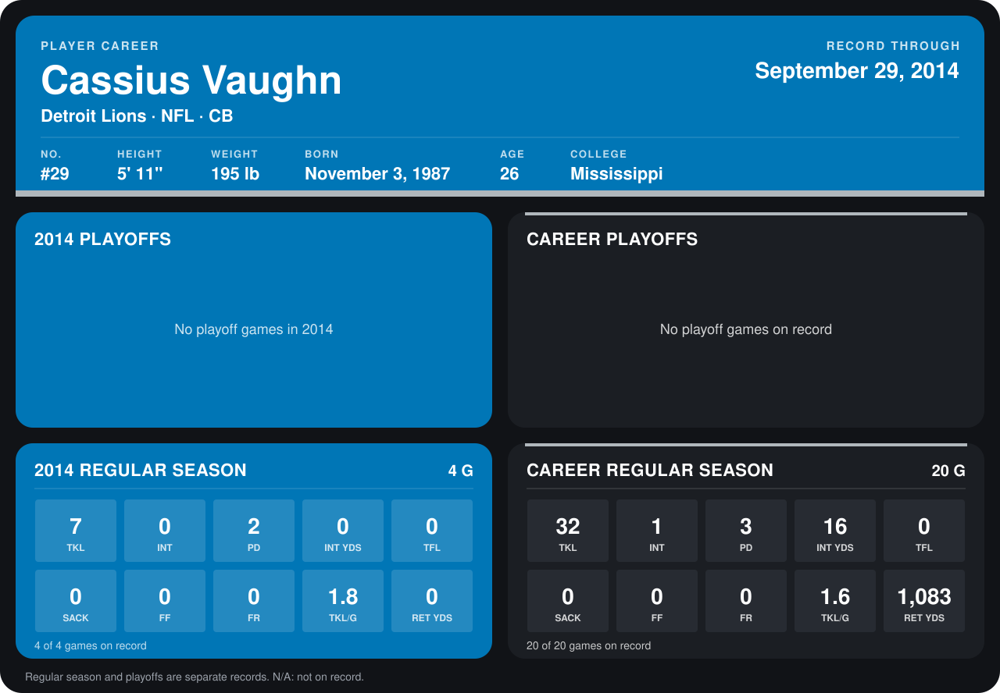

# Cassius Vaughn

## Career stats

### Regular season

| Season | Team | Age | # | G | TKL | INT | PD | INT YDS | TFL | SACK | FF | FR | TKL/G | RET YDS |
|---|---|---:|---:|---:|---:|---:|---:|---:|---:|---:|---:|---:|---:|---:|
| 2013 | Indianapolis Colts | 25 | 32 | 16 | 25 | 1 | 1 | 16 | 0 | 0 | 0 | 0 | 1.6 | 1,083 |
| 2014 | Detroit Lions | 26 | 29 | 4 | 7 | 0 | 2 | 0 | 0 | 0 | 0 | 0 | 1.8 | 0 |
| **Career** |  |  |  | 20 | 32 | 1 | 3 | 16 | 0 | 0 | 0 | 0 | 1.6 | 1,083 |

### Playoffs

No playoff games on record.

## Awards

None on record.

Age is his age on the league's opening game of each season; # is the number listed for him that season with that team (2014: the card's rule; 2013: the 2013 season roster), N/A where no listing applies.

Records through September 28, 2014. Identity: listed 2014 roster data, Weeks 1-4; number: 2014 Week 1 roster. [All Detroit Lions players](README.md).
