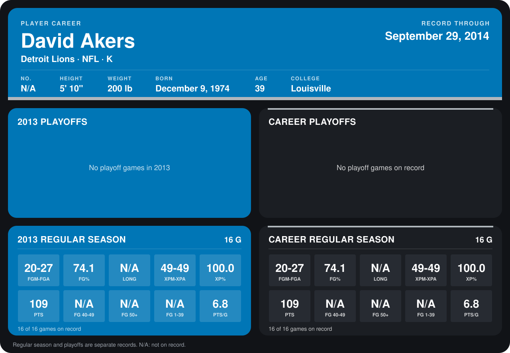

# David Akers

## Career stats

### Regular season

| Season | Team | Age | # | G | FGM-FGA | FG% | LONG | XPM-XPA | XP% | PTS | FG 40-49 | FG 50+ | FG 1-39 | PTS/G |
|---|---|---:|---:|---:|---:|---:|---:|---:|---:|---:|---:|---:|---:|---:|
| 2013 | Detroit Lions | 38 | 2 | 16 | 20-27 | 74.1 | N/A | 49-49 | 100.0 | 109 | N/A | N/A | N/A | 6.8 |
| **Career** |  |  |  | 16 | 20-27 | 74.1 | N/A | 49-49 | 100.0 | 109 | N/A | N/A | N/A | 6.8 |

### Playoffs

No playoff games on record.

## Awards

None on record.

Age is his age on the league's opening game of each season; # is the number listed for him that season with that team (2014: the card's rule; 2013: the 2013 season roster), N/A where no listing applies.

Records through December 29, 2013. Identity: his listed 2013 season roster data (no 2014 Weeks 1-4 roster row). [All Detroit Lions players](README.md).
