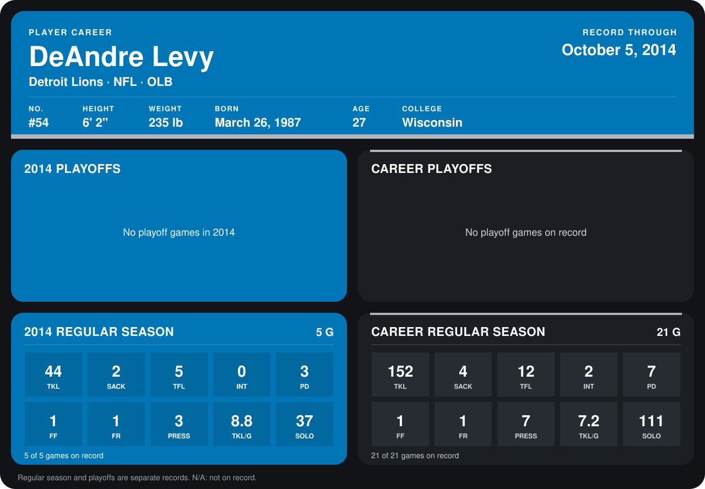

# DeAndre Levy

## Career stats

### Regular season

| Season | Club | G | TKL | SACK | TFL | INT | PD | FF | FR | PRESS | TKL/G | SOLO |
|---|---|---:|---:|---:|---:|---:|---:|---:|---:|---:|---:|---:|
| 2013 | Detroit Lions | 16 | 108 | 2 | 7 | 2 | 4 | 0 | 0 | 4 | 6.8 | 74 |
| 2014 | Detroit Lions | 5 | 44 | 2 | 5 | 0 | 3 | 1 | 1 | 3 | 8.8 | 37 |
| **Career** |  | 21 | 152 | 4 | 12 | 2 | 7 | 1 | 1 | 7 | 7.2 | 111 |

### Playoffs

No playoff games on record.

## Awards

None on record.

Records through October 5, 2014. Identity: listed 2014 roster data, Weeks 1-4; number: 2014 Week 1 roster. [All Detroit Lions players](README.md).
