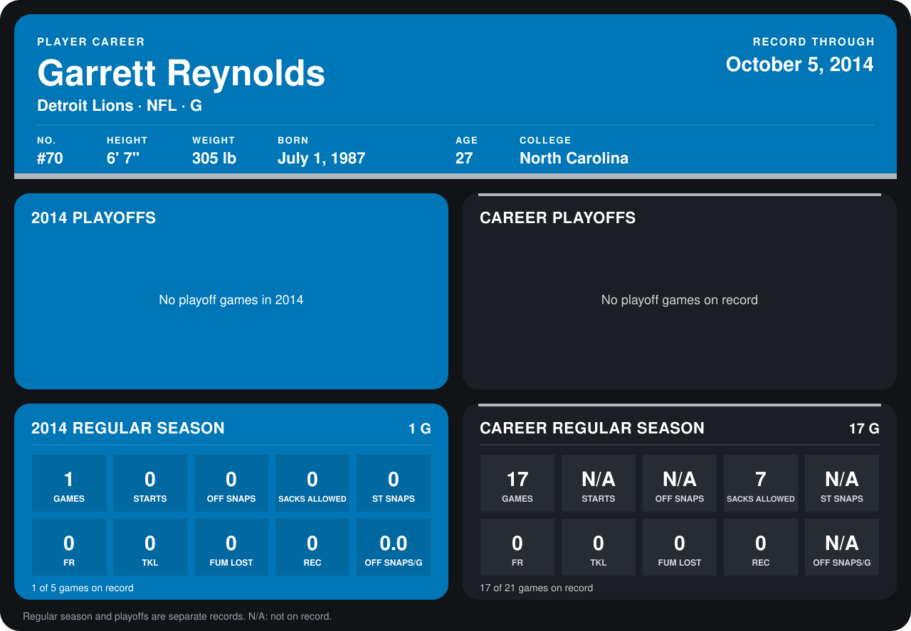

# Garrett Reynolds

## Career stats

### Regular season

| Season | Club | G | STARTS | OFF SNAPS | SACKS ALLOWED | ST SNAPS | FR | TKL | FUM LOST | REC | OFF SNAPS/G |
|---|---|---:|---:|---:|---:|---:|---:|---:|---:|---:|---:|
| 2013 | Atlanta Falcons | 16 | N/A | N/A | 7 | N/A | 0 | 0 | 0 | 0 | N/A |
| 2014 | Detroit Lions | 1 | 0 | 0 | 0 | 0 | 0 | 0 | 0 | 0 | 0.0 |
| **Career** |  | 17 | N/A | N/A | 7 | N/A | 0 | 0 | 0 | 0 | N/A |

### Playoffs

No playoff games on record.

## Awards

- Pro Bowl selection (2013, G)

Records through October 5, 2014. Identity: listed 2014 roster data, Weeks 1-4; number: 2014 Week 4 roster listing. [All Detroit Lions players](README.md).
