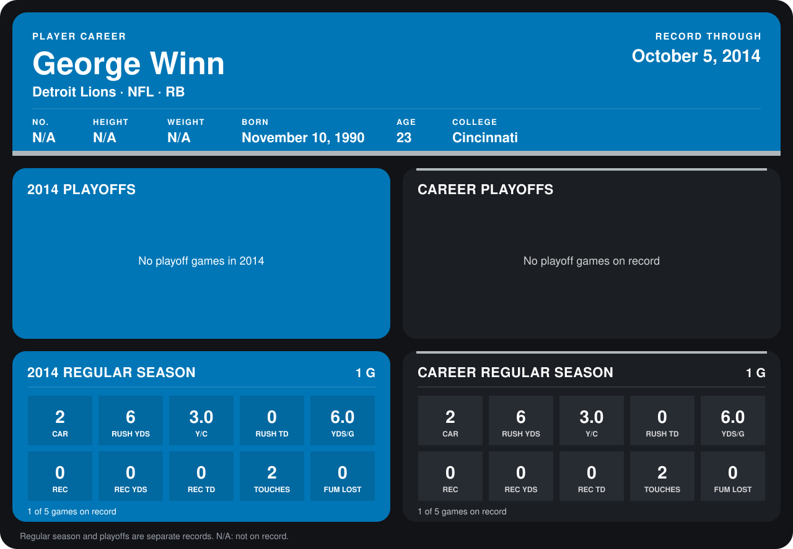

# George Winn

## Career stats

### Regular season

| Season | Club | G | CAR | RUSH YDS | Y/C | RUSH TD | YDS/G | REC | REC YDS | REC TD | TOUCHES | FUM LOST |
|---|---|---:|---:|---:|---:|---:|---:|---:|---:|---:|---:|---:|
| 2014 | Detroit Lions | 1 | 2 | 6 | 3.0 | 0 | 6.0 | 0 | 0 | 0 | 2 | 0 |
| **Career** |  | 1 | 2 | 6 | 3.0 | 0 | 6.0 | 0 | 0 | 0 | 2 | 0 |

### Playoffs

No playoff games on record.

## Awards

None on record.

Records through October 5, 2014. Identity: the public player file's college (no 2014 Weeks 1-4 or 2013 roster row). [All Detroit Lions players](README.md).
