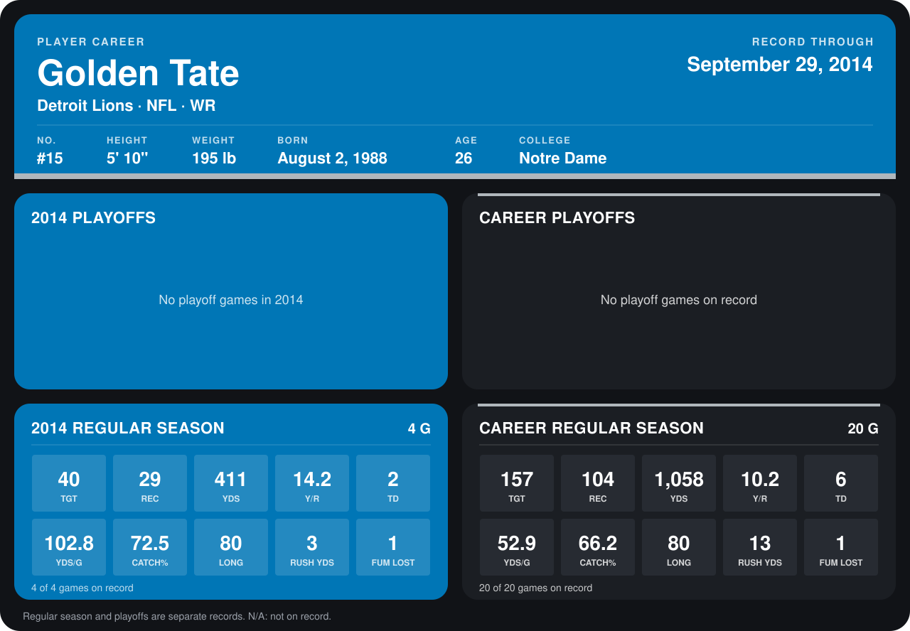

# Golden Tate

## Career stats

### Regular season

| Season | Team | Age | # | G | TGT | REC | YDS | Y/R | TD | YDS/G | CATCH% | LONG | RUSH YDS | FUM LOST |
|---|---|---:|---:|---:|---:|---:|---:|---:|---:|---:|---:|---:|---:|---:|
| 2013 | Seattle Seahawks | 25 | 81 | 16 | 117 | 75 | 647 | 8.6 | 4 | 40.4 | 64.1 | 74 | 10 | 0 |
| 2014 | Detroit Lions | 26 | 15 | 4 | 40 | 29 | 411 | 14.2 | 2 | 102.8 | 72.5 | 80 | 3 | 1 |
| **Career** |  |  |  | 20 | 157 | 104 | 1,058 | 10.2 | 6 | 52.9 | 66.2 | 80 | 13 | 1 |

### Playoffs

No playoff games on record.

## Awards

None on record.

Age is his age on the league's opening game of each season; # is the number listed for him that season with that team (2014: the card's rule; 2013: the 2013 season roster), N/A where no listing applies.

Records through September 28, 2014. Identity: listed 2014 roster data, Weeks 1-4; number: 2014 Week 1 roster. [All Detroit Lions players](README.md).
