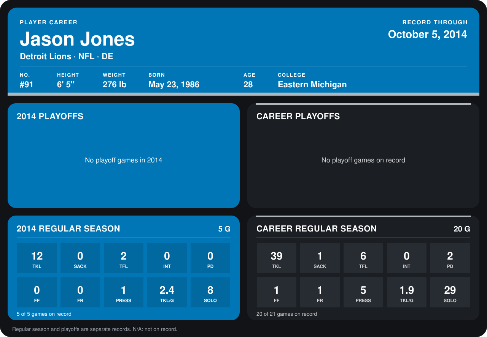

# Jason Jones

## Career stats

### Regular season

| Season | Club | G | TKL | SACK | TFL | INT | PD | FF | FR | PRESS | TKL/G | SOLO |
|---|---|---:|---:|---:|---:|---:|---:|---:|---:|---:|---:|---:|
| 2013 | Detroit Lions | 15 | 27 | 1 | 4 | 0 | 2 | 1 | 1 | 4 | 1.8 | 21 |
| 2014 | Detroit Lions | 4 | 11 | 0 | 2 | 0 | 0 | 0 | 0 | 1 | 2.8 | 7 |
| **Career** |  | 19 | 38 | 1 | 6 | 0 | 2 | 1 | 1 | 5 | 2.0 | 28 |

### Playoffs

No playoff games on record.

## Awards

None on record.

Records through September 28, 2014. Identity: listed 2014 roster data, Weeks 1-4; number: 2014 Week 1 roster. [All Detroit Lions players](README.md).
