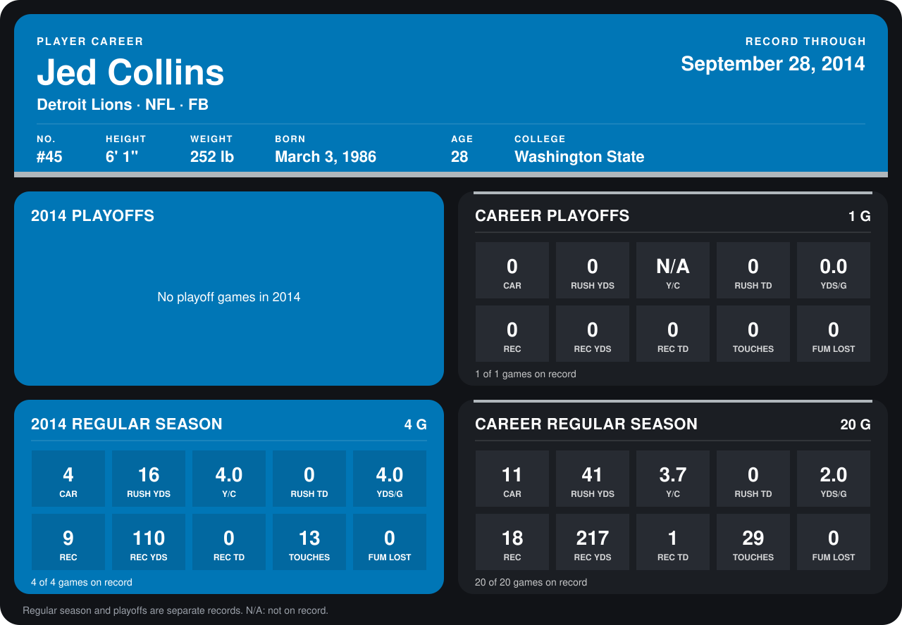

# Jed Collins

## Career stats

### Regular season

| Season | Club | G | CAR | RUSH YDS | Y/C | RUSH TD | YDS/G | REC | REC YDS | REC TD | TOUCHES | FUM LOST |
|---|---|---:|---:|---:|---:|---:|---:|---:|---:|---:|---:|---:|
| 2013 | New Orleans Saints | 16 | 7 | 25 | 3.6 | 0 | 1.6 | 9 | 107 | 1 | 16 | 0 |
| 2014 | Detroit Lions | 4 | 4 | 16 | 4.0 | 0 | 4.0 | 9 | 110 | 0 | 13 | 0 |
| **Career** |  | 20 | 11 | 41 | 3.7 | 0 | 2.0 | 18 | 217 | 1 | 29 | 0 |

### Playoffs

| Season | Club | G | CAR | RUSH YDS | Y/C | RUSH TD | YDS/G | REC | REC YDS | REC TD | TOUCHES | FUM LOST |
|---|---|---:|---:|---:|---:|---:|---:|---:|---:|---:|---:|---:|
| 2013 | New Orleans Saints | 1 | 0 | 0 | N/A | 0 | 0.0 | 0 | 0 | 0 | 0 | 0 |
| **Career** |  | 1 | 0 | 0 | N/A | 0 | 0.0 | 0 | 0 | 0 | 0 | 0 |

## Awards

None on record.

Records through September 28, 2014. Identity: listed 2014 roster data, Weeks 1-4; number: 2014 Week 1 roster. [All Detroit Lions players](README.md).
