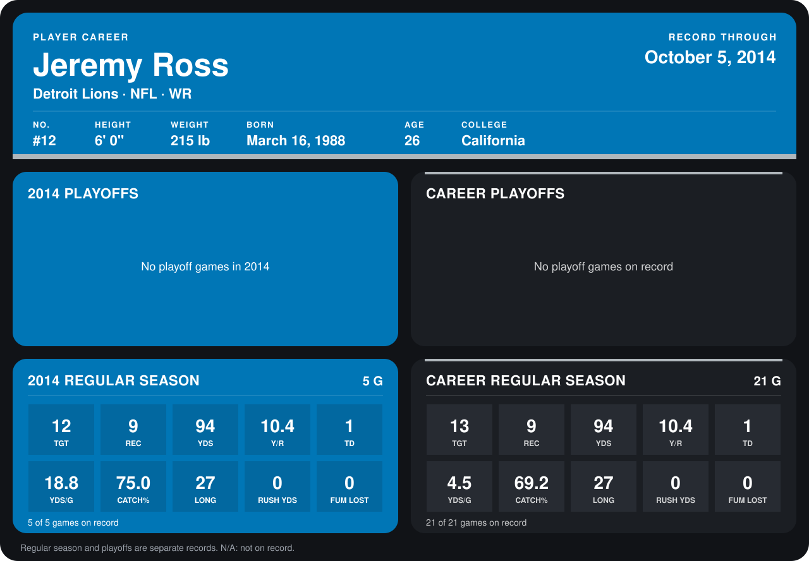

# Jeremy Ross

## Career stats

### Regular season

| Season | Club | G | TGT | REC | YDS | Y/R | TD | YDS/G | CATCH% | LONG | RUSH YDS | FUM LOST |
|---|---|---:|---:|---:|---:|---:|---:|---:|---:|---:|---:|---:|
| 2013 | Green Bay Packers | 16 | 1 | 0 | 0 | N/A | 0 | 0.0 | 0.0 | N/A | 0 | 0 |
| 2014 | Detroit Lions | 4 | 3 | 2 | 20 | 10.0 | 0 | 5.0 | 66.7 | 14 | 0 | 0 |
| **Career** |  | 20 | 4 | 2 | 20 | 10.0 | 0 | 1.0 | 50.0 | 14 | 0 | 0 |

### Playoffs

No playoff games on record.

## Awards

- NFC Special Teams Player of the Week (2013, Week 5)
- NFC Special Teams Player of the Week (2013, Week 11)

Records through September 28, 2014. Identity: listed 2014 roster data, Weeks 1-4; number: 2014 Week 1 roster. [All Detroit Lions players](README.md).
