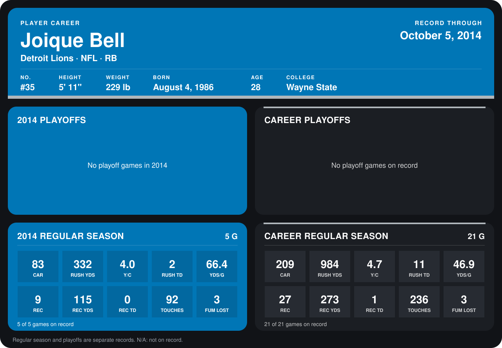

# Joique Bell

## Career stats

### Regular season

| Season | Club | G | CAR | RUSH YDS | Y/C | RUSH TD | YDS/G | REC | REC YDS | REC TD | TOUCHES | FUM LOST |
|---|---|---:|---:|---:|---:|---:|---:|---:|---:|---:|---:|---:|
| 2013 | Detroit Lions | 16 | 126 | 652 | 5.2 | 9 | 40.8 | 18 | 158 | 1 | 144 | 0 |
| 2014 | Detroit Lions | 4 | 69 | 288 | 4.2 | 2 | 72.0 | 7 | 72 | 0 | 76 | 3 |
| **Career** |  | 20 | 195 | 940 | 4.8 | 11 | 47.0 | 25 | 230 | 1 | 220 | 3 |

### Playoffs

No playoff games on record.

## Awards

None on record.

Records through September 29, 2014. Identity: listed 2014 roster data, Weeks 1-4; number: 2014 Week 1 roster. [All Detroit Lions players](README.md).
