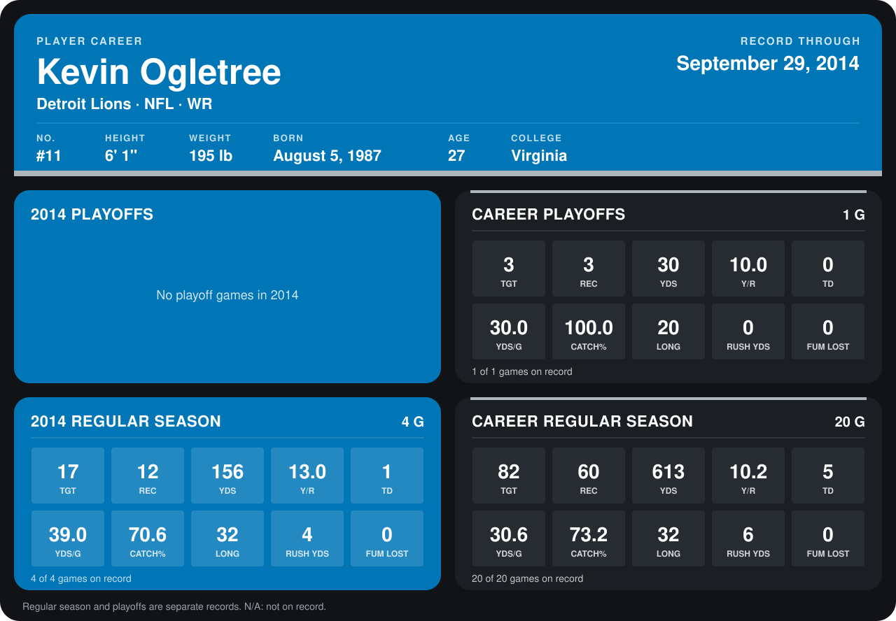

# Kevin Ogletree

## Career stats

### Regular season

| Season | Club | G | TGT | REC | YDS | Y/R | TD | YDS/G | CATCH% | LONG | RUSH YDS | FUM LOST |
|---|---|---:|---:|---:|---:|---:|---:|---:|---:|---:|---:|---:|
| 2013 | Tampa Bay Buccaneers | 16 | 65 | 48 | 457 | 9.5 | 4 | 28.6 | 73.8 | 31 | 2 | 0 |
| 2014 | Detroit Lions | 4 | 17 | 12 | 156 | 13.0 | 1 | 39.0 | 70.6 | 32 | 4 | 0 |
| **Career** |  | 20 | 82 | 60 | 613 | 10.2 | 5 | 30.6 | 73.2 | 32 | 6 | 0 |

### Playoffs

| Season | Club | G | TGT | REC | YDS | Y/R | TD | YDS/G | CATCH% | LONG | RUSH YDS | FUM LOST |
|---|---|---:|---:|---:|---:|---:|---:|---:|---:|---:|---:|---:|
| 2013 | Tampa Bay Buccaneers | 1 | 3 | 3 | 30 | 10.0 | 0 | 30.0 | 100.0 | 20 | 0 | 0 |
| **Career** |  | 1 | 3 | 3 | 30 | 10.0 | 0 | 30.0 | 100.0 | 20 | 0 | 0 |

## Awards

None on record.

Records through September 28, 2014. Identity: listed 2014 roster data, Weeks 1-4; number: 2014 Week 1 roster. [All Detroit Lions players](README.md).
