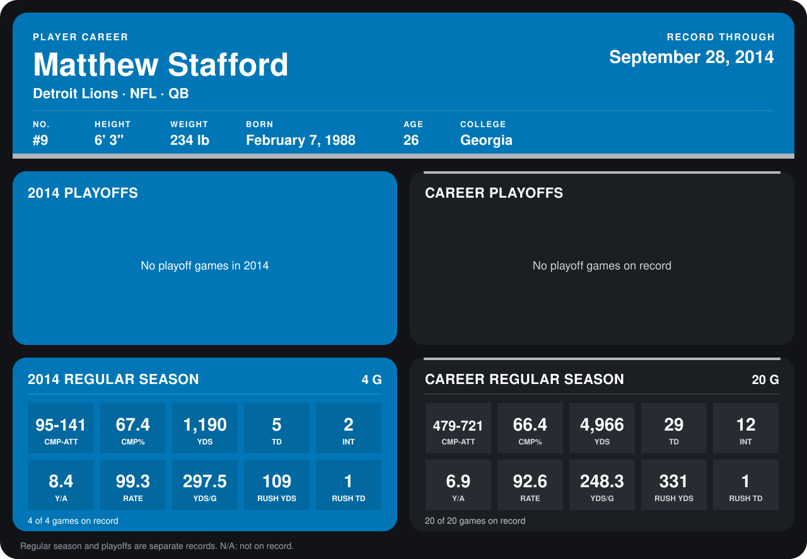

# Matthew Stafford

## Career stats

### Regular season

| Season | Club | G | CMP-ATT | CMP% | YDS | TD | INT | Y/A | RATE | YDS/G | RUSH YDS | RUSH TD |
|---|---|---:|---:|---:|---:|---:|---:|---:|---:|---:|---:|---:|
| 2013 | Detroit Lions | 16 | 384-580 | 66.2 | 3,776 | 24 | 10 | 6.5 | 91.0 | 236.0 | 222 | 0 |
| 2014 | Detroit Lions | 5 | 125-185 | 67.6 | 1,532 | 8 | 2 | 8.3 | 102.8 | 306.4 | 109 | 1 |
| **Career** |  | 21 | 509-765 | 66.5 | 5,308 | 32 | 12 | 6.9 | 93.8 | 252.8 | 331 | 1 |

### Playoffs

No playoff games on record.

## Awards

None on record.

Records through October 5, 2014. Identity: listed 2014 roster data, Weeks 1-4; number: 2014 Week 1 roster. [All Detroit Lions players](README.md).
