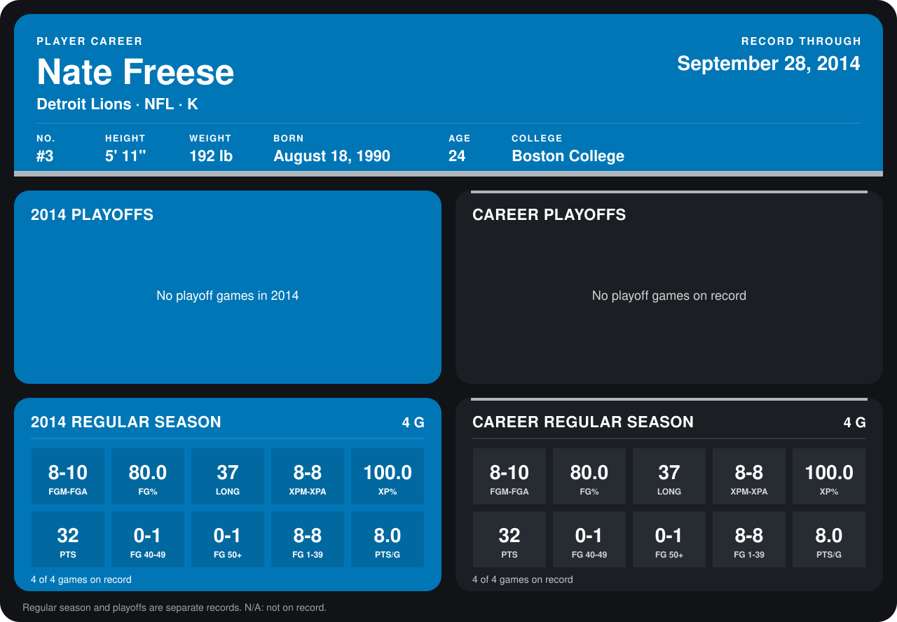

# Nate Freese

## Career stats

### Regular season

| Season | Club | G | FGM-FGA | FG% | LONG | XPM-XPA | XP% | PTS | FG 40-49 | FG 50+ | FG 1-39 | PTS/G |
|---|---|---:|---:|---:|---:|---:|---:|---:|---:|---:|---:|---:|
| 2014 | Detroit Lions | 4 | 8-10 | 80.0 | 37 | 8-8 | 100.0 | 32 | 0-1 | 0-1 | 8-8 | 8.0 |
| **Career** |  | 4 | 8-10 | 80.0 | 37 | 8-8 | 100.0 | 32 | 0-1 | 0-1 | 8-8 | 8.0 |

### Playoffs

No playoff games on record.

## Awards

None on record.

Records through September 29, 2014. Identity: listed 2014 roster data, Weeks 1-4; number: 2014 Week 1 roster. [All Detroit Lions players](README.md).
