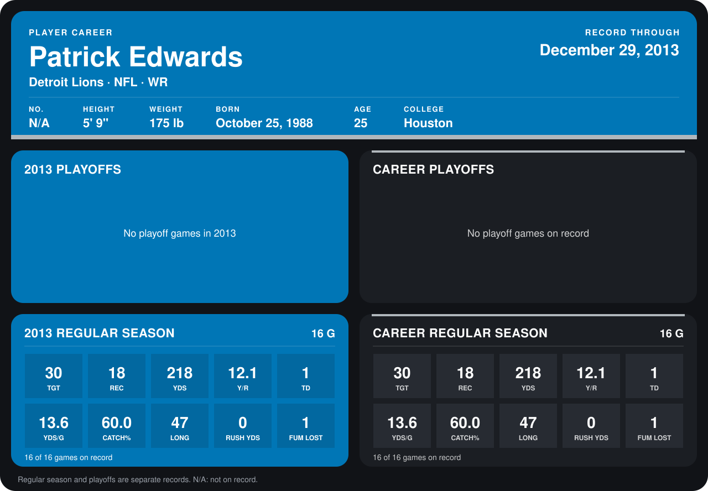

# Patrick Edwards

## Career stats

### Regular season

| Season | Club | G | TGT | REC | YDS | Y/R | TD | YDS/G | CATCH% | LONG | RUSH YDS | FUM LOST |
|---|---|---:|---:|---:|---:|---:|---:|---:|---:|---:|---:|---:|
| 2013 | Detroit Lions | 16 | 30 | 18 | 218 | 12.1 | 1 | 13.6 | 60.0 | 47 | 0 | 1 |
| **Career** |  | 16 | 30 | 18 | 218 | 12.1 | 1 | 13.6 | 60.0 | 47 | 0 | 1 |

### Playoffs

No playoff games on record.

## Awards

None on record.

Records through September 29, 2014. Identity: the public player file's latest listing (no 2014 Weeks 1-4 roster row). [All Detroit Lions players](README.md).
