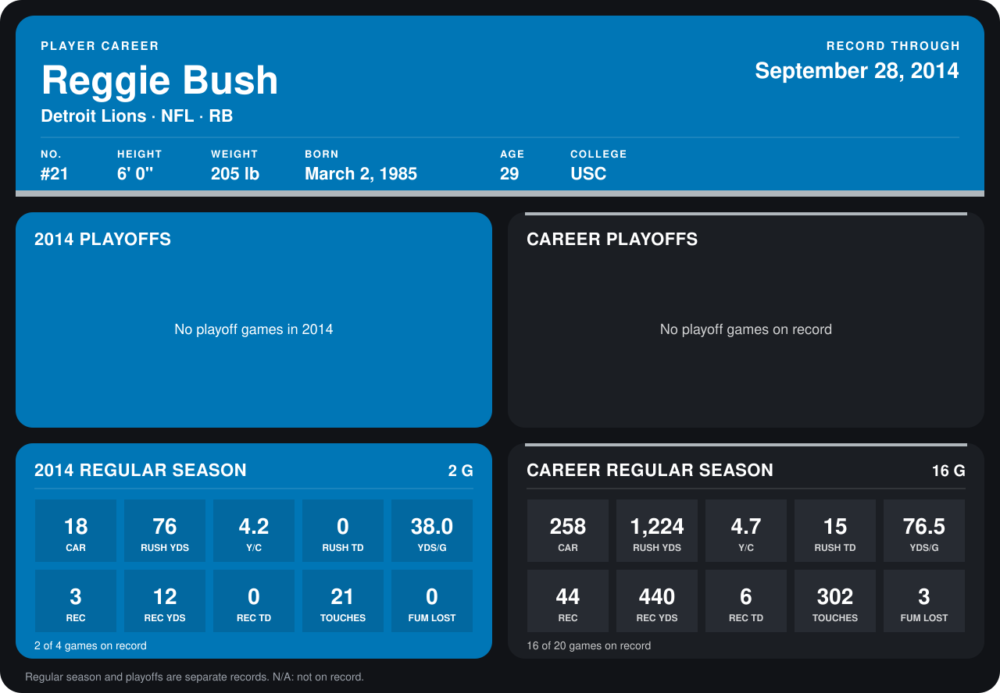

# Reggie Bush

## Career stats

### Regular season

| Season | Club | G | CAR | RUSH YDS | Y/C | RUSH TD | YDS/G | REC | REC YDS | REC TD | TOUCHES | FUM LOST |
|---|---|---:|---:|---:|---:|---:|---:|---:|---:|---:|---:|---:|
| 2013 | Detroit Lions | 14 | 240 | 1,148 | 4.8 | 15 | 82.0 | 41 | 428 | 6 | 281 | 3 |
| 2014 | Detroit Lions | 2 | 18 | 76 | 4.2 | 0 | 38.0 | 3 | 12 | 0 | 21 | 0 |
| **Career** |  | 16 | 258 | 1,224 | 4.7 | 15 | 76.5 | 44 | 440 | 6 | 302 | 3 |

### Playoffs

No playoff games on record.

## Awards

- NFC Offensive Player of the Week (2013, Week 5)
- NFC Offensive Player of the Week (2013, Week 6)
- NFC Offensive Player of the Month (2013, October)
- NFC Offensive Player of the Week (2013, Week 15)
- Pro Bowl selection (2013, RB)

Records through September 29, 2014. Identity: listed 2014 roster data, Weeks 1-4; number: 2014 Week 1 roster. [All Detroit Lions players](README.md).
