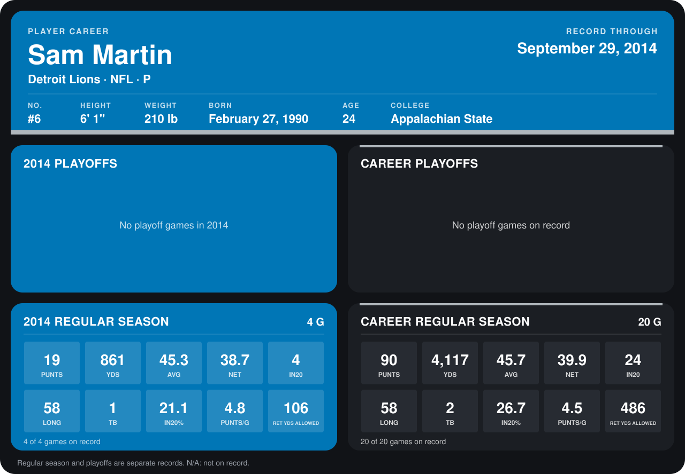

# Sam Martin

## Career stats

### Regular season

| Season | Club | G | PUNTS | YDS | AVG | NET | IN20 | LONG | TB | IN20% | PUNTS/G | RET YDS ALLOWED |
|---|---|---:|---:|---:|---:|---:|---:|---:|---:|---:|---:|---:|
| 2013 | Detroit Lions | 16 | 71 | 3,256 | 45.9 | 40.2 | 20 | 58 | 1 | 28.2 | 4.4 | 380 |
| 2014 | Detroit Lions | 4 | 19 | 861 | 45.3 | 38.7 | 4 | 58 | 1 | 21.1 | 4.8 | 106 |
| **Career** |  | 20 | 90 | 4,117 | 45.7 | 39.9 | 24 | 58 | 2 | 26.7 | 4.5 | 486 |

### Playoffs

No playoff games on record.

## Awards

None on record.

Records through September 28, 2014. Identity: listed 2014 roster data, Weeks 1-4; number: 2014 Week 1 roster. [All Detroit Lions players](README.md).
