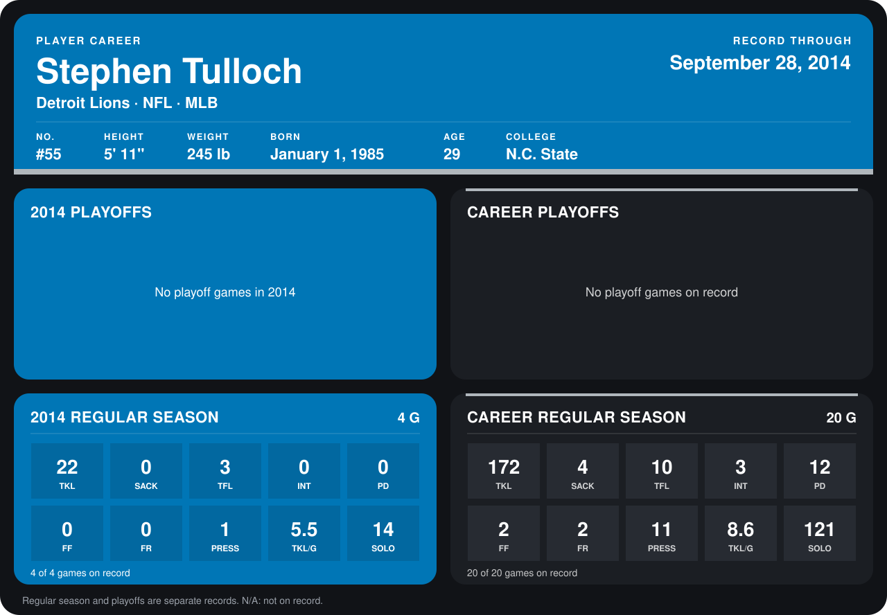

# Stephen Tulloch

## Career stats

### Regular season

| Season | Club | G | TKL | SACK | TFL | INT | PD | FF | FR | PRESS | TKL/G | SOLO |
|---|---|---:|---:|---:|---:|---:|---:|---:|---:|---:|---:|---:|
| 2013 | Detroit Lions | 16 | 150 | 4 | 7 | 3 | 12 | 2 | 2 | 10 | 9.4 | 107 |
| 2014 | Detroit Lions | 4 | 22 | 0 | 3 | 0 | 0 | 0 | 0 | 1 | 5.5 | 14 |
| **Career** |  | 20 | 172 | 4 | 10 | 3 | 12 | 2 | 2 | 11 | 8.6 | 121 |

### Playoffs

No playoff games on record.

## Awards

- NFC Defensive Player of the Month (2013, December)
- AP Second-Team All-Pro (2013, ILB)
- Pro Bowl selection (2013, ILB)

Records through September 28, 2014. Identity: listed 2014 roster data, Weeks 1-4; number: 2014 Week 1 roster. [All Detroit Lions players](README.md).
