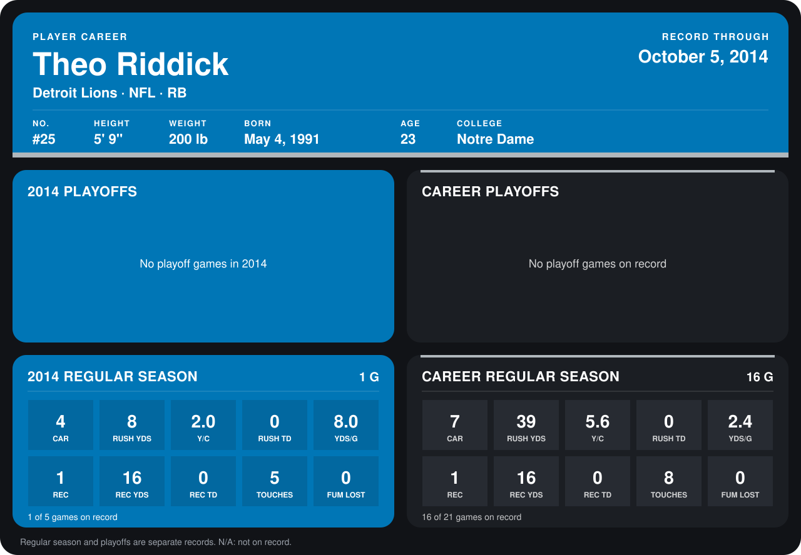

# Theo Riddick

## Career stats

### Regular season

| Season | Club | G | CAR | RUSH YDS | Y/C | RUSH TD | YDS/G | REC | REC YDS | REC TD | TOUCHES | FUM LOST |
|---|---|---:|---:|---:|---:|---:|---:|---:|---:|---:|---:|---:|
| 2013 | Detroit Lions | 15 | 3 | 31 | 10.3 | 0 | 2.1 | 0 | 0 | 0 | 3 | 0 |
| 2014 | Detroit Lions | 1 | 4 | 8 | 2.0 | 0 | 8.0 | 1 | 16 | 0 | 5 | 0 |
| **Career** |  | 16 | 7 | 39 | 5.6 | 0 | 2.4 | 1 | 16 | 0 | 8 | 0 |

### Playoffs

No playoff games on record.

## Awards

None on record.

Records through October 5, 2014. Identity: listed 2014 roster data, Weeks 1-4; number: 2014 Week 4 roster listing. [All Detroit Lions players](README.md).
