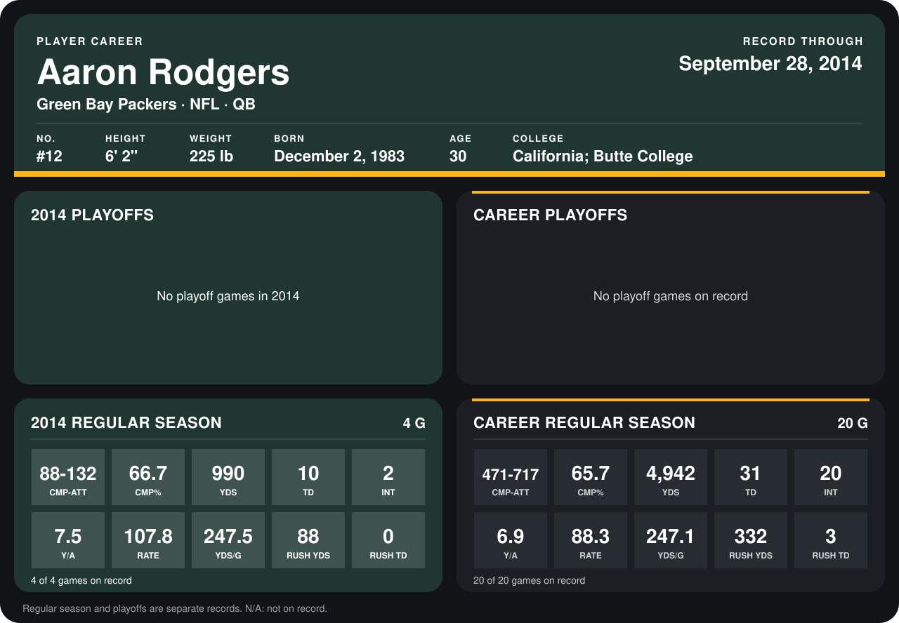

# Aaron Rodgers

## Career stats

### Regular season

| Season | Club | G | CMP-ATT | CMP% | YDS | TD | INT | Y/A | RATE | YDS/G | RUSH YDS | RUSH TD |
|---|---|---:|---:|---:|---:|---:|---:|---:|---:|---:|---:|---:|
| 2013 | Green Bay Packers | 16 | 383-585 | 65.5 | 3,952 | 21 | 18 | 6.8 | 83.9 | 247.0 | 244 | 3 |
| 2014 | Green Bay Packers | 4 | 88-132 | 66.7 | 990 | 10 | 2 | 7.5 | 107.8 | 247.5 | 88 | 0 |
| **Career** |  | 20 | 471-717 | 65.7 | 4,942 | 31 | 20 | 6.9 | 88.3 | 247.1 | 332 | 3 |

### Playoffs

No playoff games on record.

## Awards

- NFC Offensive Player of the Week (2013, Week 14)
- NFC Offensive Player of the Month (2013, December)
- NFC Offensive Player of the Week (2014, Week 2)

Records through September 28, 2014. Identity: listed 2014 roster data, Weeks 1-4; number: 2014 Week 1 roster. [All Green Bay Packers players](README.md).
